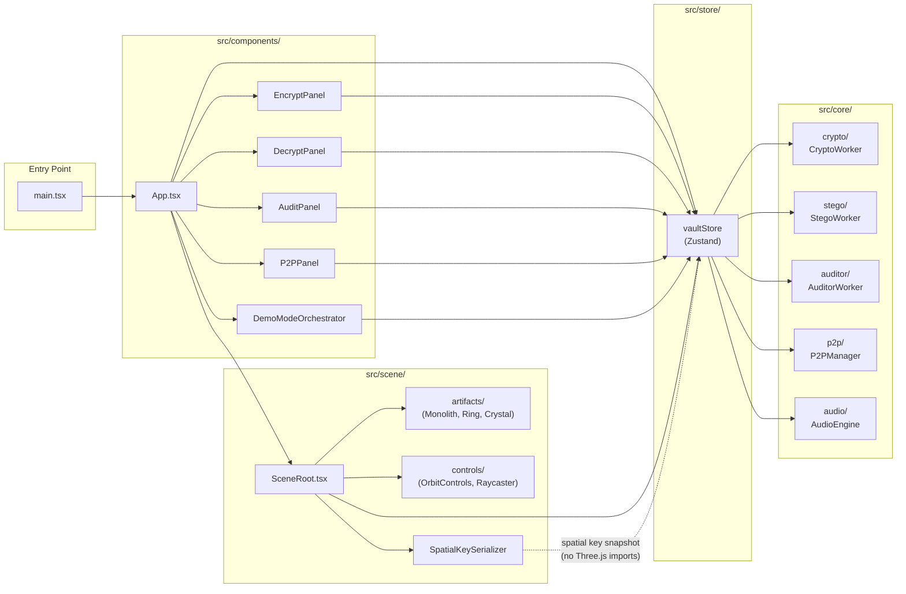
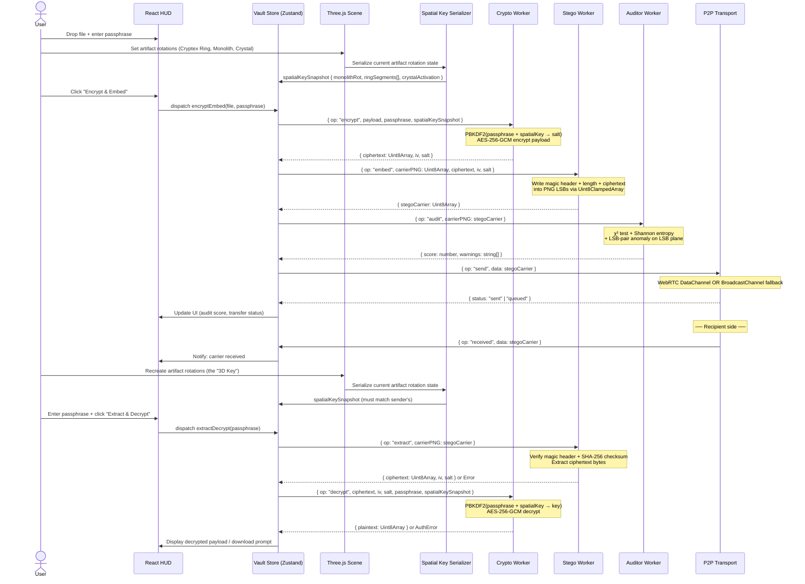
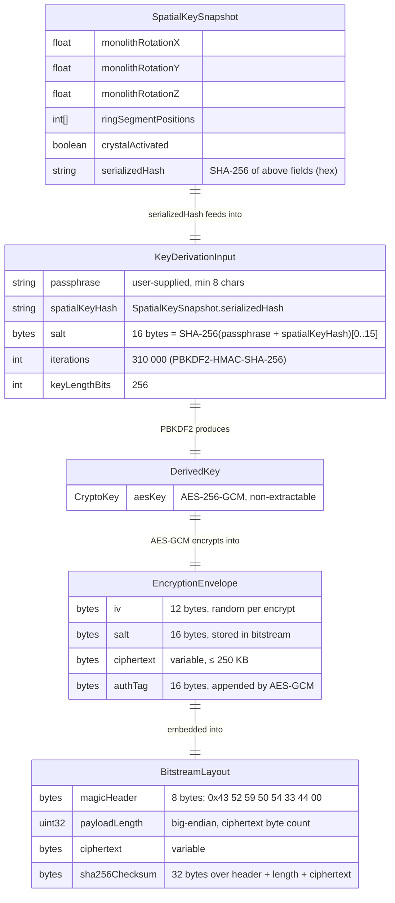
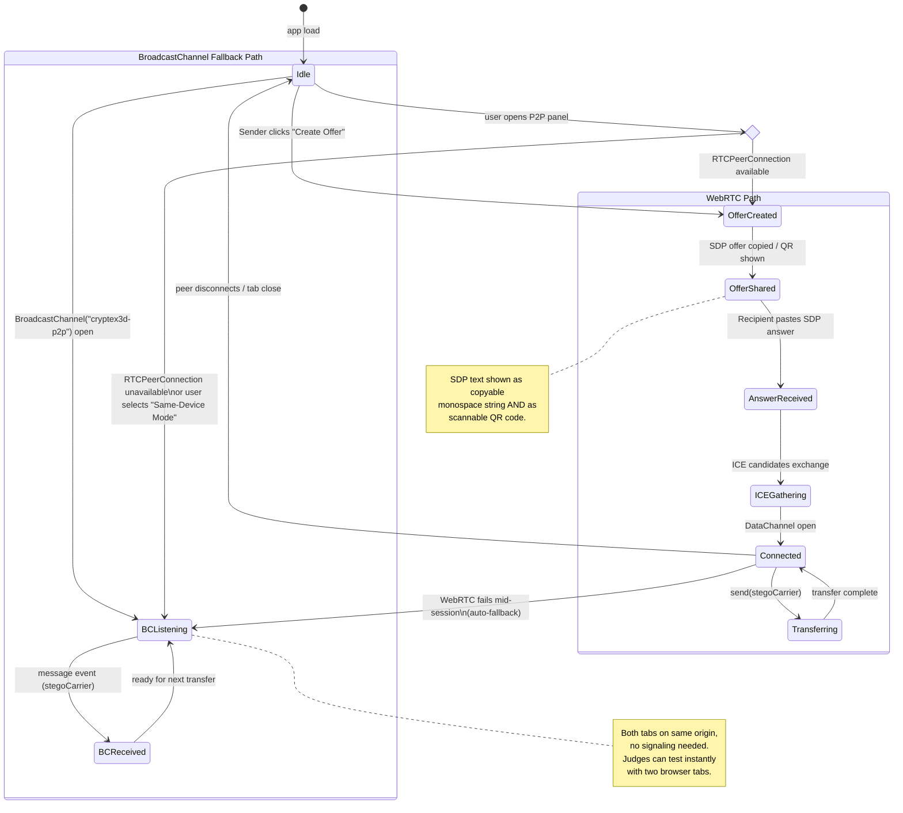
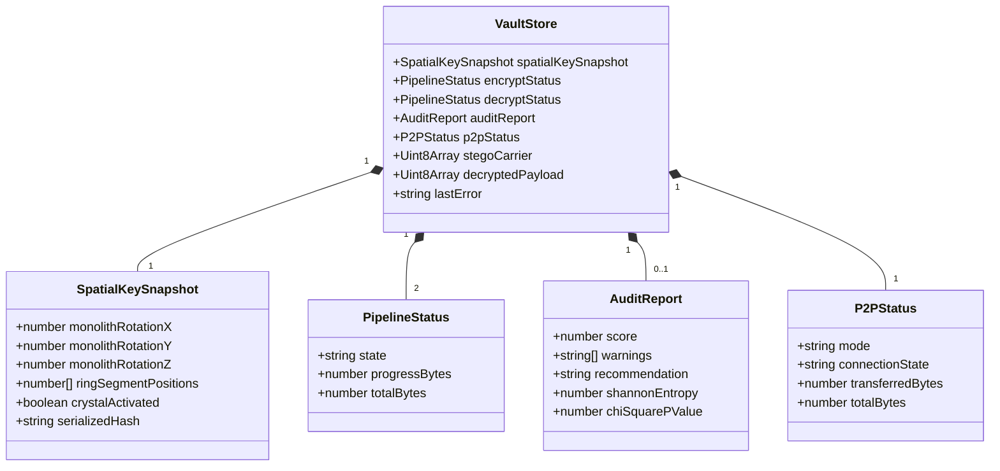

# Design Document: Cryptex3D

## Overview

Cryptex3D is a zero-knowledge, 100% browser-native encrypted dead-drop disguised as an interactive 3D atmospheric vault. Users encrypt arbitrary payloads (up to 250 KB) into lossless PNG carrier textures, transfer them peer-to-peer via WebRTC DataChannels (or multi-tab BroadcastChannel), and decrypt them by recreating the exact 3D artifact state used during encryption — with no backend, no server, and no account. The project is built for the Kiroween 2026 Hackathon (Frankenstein category) and is hosted at `zaki5544/cryptex3d` on GitHub under the MIT license.

The application runs entirely in the browser using TypeScript, React 19, Vite, Tailwind CSS, Three.js, and browser-native Web Crypto API. Every computationally intensive operation (crypto, steganography, entropy auditing) executes off the main thread inside dedicated Web Workers, leaving the Three.js render loop uncontested at 60 fps.

## Architecture

```mermaid
graph TD
    subgraph Browser["Browser (Single Origin, Zero Backend)"]
        subgraph UI["React 19 UI Layer"]
            HUD["Glassmorphic HUD Panels\n(Zustand state)"]
            DemoBtn["Judge Demo Mode Button"]
        end

        subgraph Scene["Three.js Scene Layer (60 fps)"]
            Renderer["WebGLRenderer + OrbitControls"]
            Monolith["Obsidian Monolith\n(draggable rotation)"]
            Ring["Cryptex Ring\n(click-to-rotate segments)"]
            Crystal["Ethereal Crystal\n(hover glow)"]
            Raycaster["Raycaster + Artifact Selector"]
            SpatialKey["3D Spatial Key Serializer"]
        end

        subgraph Workers["Web Worker Pipeline Layer"]
            CryptoWorker["Crypto Worker\n(AES-256-GCM + PBKDF2)"]
            StegoWorker["Stego Worker\n(LSB embed / extract)"]
            AuditorWorker["Auditor Worker\n(χ² + entropy + LSB-pair)"]
        end

        subgraph Transport["P2P Transport Layer"]
            WebRTC["WebRTC DataChannel\n(manual SDP / QR)"]
            BC["BroadcastChannel\n(multi-tab fallback)"]
        end

        subgraph Audio["Web Audio Layer"]
            Ambient["Procedural Ambient Soundscape"]
            Tactile["Spatial Click / Interaction SFX"]
        end
    end

    HUD -->|"user actions / selectors"| Scene
    Scene -->|"spatial key snapshot"| Workers
    HUD -->|"passphrase + file"| Workers
    Workers -->|"carrier PNG bytes"| Transport
    Transport -->|"received PNG bytes"| Workers
    Workers -->|"decrypted payload + audit report"| HUD
    Scene -->|"camera position"| Audio
    DemoBtn -->|"orchestrates full pipeline"| Workers
```

## Module Dependency Graph

## Encrypt → Embed → Transfer → Extract → Decrypt Pipeline

## Key Derivation Data Model

## WebRTC / BroadcastChannel State Machine

## Components and Interfaces

### Three.js Scene (`src/scene/`)

**Purpose**: Renders the 3D vault environment at 60 fps and serializes artifact interaction state into the Spatial Key.

| Component | Responsibility |
|---|---|
| `SceneRoot` | Mounts `WebGLRenderer`, manages `requestAnimationFrame` loop, handles resize, disposes all GPU resources on unmount |
| `ObsidianMonolith` | Renders a beveled box geometry with PBR material; exposes drag-rotation via pointer events; emits rotation state on change |
| `CryptexRing` | Renders N cylindrical ring segments; click advances each segment through 10 discrete positions (0–9); emits combined segment state |
| `EtherealCrystal` | Renders icosahedral geometry with transmission/emissive material; hover triggers glow animation and sets `crystalActivated` state |
| `OrbitControlsWrapper` | Wraps Three.js `OrbitControls`; disabled during artifact interaction |
| `ArtifactRaycaster` | Performs per-frame raycasting; routes pointer events to the correct artifact |
| `SpatialKeySerializer` | Pure serializer: takes artifact states from scene events and writes `SpatialKeySnapshot` to Zustand store |
| `WebGLFallback` | Renders an accessible `<canvas>` error message if `WebGLRenderer` creation fails |

**Scene State Flow**:
- Artifact interaction events → `SpatialKeySerializer` → Zustand `vaultStore.spatialKeySnapshot`
- Main thread React state never reaches inside the render loop; communication is one-way via event emitter

### Cryptography Module (`src/core/crypto/`)

**Purpose**: AES-256-GCM encryption/decryption and PBKDF2 key derivation, isolated in a Web Worker.

| Component | Responsibility |
|---|---|
| `CryptoWorker` | Long-lived `Worker` thread; handles `encrypt` and `decrypt` message operations |
| `KeyDeriver` | Builds PBKDF2 input from passphrase + spatial key hash; calls `crypto.subtle.deriveKey` |
| `Encryptor` | Generates random IV, calls `crypto.subtle.encrypt` with AES-GCM |
| `Decryptor` | Reconstructs key from stored salt + current spatial key, calls `crypto.subtle.decrypt` |

### Steganography Module (`src/core/stego/`)

**Purpose**: LSB embed and extract on 1024×1024 RGBA PNG carrier textures.

| Component | Responsibility |
|---|---|
| `StegoWorker` | Long-lived `Worker` thread; handles `embed` and `extract` message operations |
| `LSBEmbedder` | Writes magic header + payload length + ciphertext into least-significant bits of R, G, B channels |
| `LSBExtractor` | Reads bitstream from LSBs; verifies magic header and SHA-256 checksum before returning ciphertext |
| `CanvasTexturePatch` | Updates the Three.js `DataTexture` on the main thread after embed, with `NoColorSpace` and `generateMipmaps: false` enforced |

### Entropy Auditor (`src/core/auditor/`)

**Purpose**: Advisory detectability scoring of a stego carrier, fully off-thread.

| Component | Responsibility |
|---|---|
| `AuditorWorker` | Long-lived `Worker` thread; runs all analysis on `Uint8ClampedArray` |
| `ChiSquareTest` | Tests LSB-plane byte distribution against expected uniform distribution |
| `ShannonEntropyCalc` | Computes entropy of the LSB plane; near-8.0 bits/byte indicates high payload density |
| `LSBPairAnalyzer` | RS steganalysis variant: detects LSB-pair correlation anomalies introduced by naive LSB embedding |
| `HeuristicScorer` | Optional `@huggingface/transformers` model (loaded lazily); falls back to pure-JS weighted scoring |
| `AuditReportBuilder` | Assembles `{ score: 0–100, warnings: string[], recommendation: string }` |

### P2P Transport (`src/core/p2p/`)

**Purpose**: Transfer carrier PNG bytes between peers with zero signaling server.

| Component | Responsibility |
|---|---|
| `P2PManager` | Owns the `RTCPeerConnection` lifecycle; exposes `createOffer()`, `acceptAnswer()`, `sendData()` |
| `SDPNegotiator` | Formats SDP offer/answer as copyable monospace text and as a QR code (using `qrcode` library) |
| `DataChannelHandler` | Chunks large `Uint8Array` transfers across the `RTCDataChannel`; reassembles on the receiving end |
| `BroadcastChannelFallback` | Opens `BroadcastChannel("cryptex3d-p2p")`; activates automatically when WebRTC is unavailable or user selects same-device mode |
| `TransferProgressTracker` | Emits byte-count progress events consumed by the HUD progress indicator |

### Web Audio Engine (`src/core/audio/`)

**Purpose**: Procedural ambient and tactile audio feedback.

| Component | Responsibility |
|---|---|
| `AudioEngine` | Manages `AudioContext` lifecycle; handles browser autoplay policy (resumes on first user gesture) |
| `AmbientSynthesizer` | Generates procedural eerie soundscape using oscillators + convolution reverb |
| `SpatialMixer` | Pans and attenuates ambient sources based on camera position from the Three.js scene |
| `TactileSFX` | Plays short synthesized click sounds on cryptex ring segment rotation; pitch varies by segment index |

### React UI (`src/components/`)

**Purpose**: Glassmorphic HUD overlays for all user interactions.

| Component | Responsibility |
|---|---|
| `EncryptPanel` | File drop zone + passphrase input + "Encrypt & Embed" action |
| `DecryptPanel` | Passphrase input + "Extract & Decrypt" action + decrypted file download |
| `AuditPanel` | Displays audit score, entropy chart, warning list from `AuditorWorker` |
| `P2PPanel` | SDP offer/answer textareas + QR display + transfer progress bar + "Same-Device Mode" toggle |
| `DemoModeOrchestrator` | "Judge Demo Mode" button; orchestrates the full pipeline in < 60 s with pre-set demo payload |
| `SpatialKeyDisplay` | Read-only panel showing current artifact rotation state serialized hash |

## Data Models

### Vault Store (Zustand) — Global Application State

### PipelineStatus States

| State | Meaning |
|---|---|
| `idle` | No operation in progress |
| `deriving` | PBKDF2 key derivation running in Crypto Worker |
| `encrypting` | AES-GCM encryption running |
| `embedding` | LSB embedding running in Stego Worker |
| `auditing` | Entropy analysis running in Auditor Worker |
| `transferring` | P2P data channel transfer in progress |
| `extracting` | LSB extraction running |
| `decrypting` | AES-GCM decryption running |
| `complete` | Operation finished successfully |
| `error` | Operation failed; `lastError` contains message |

### P2PStatus Modes

| Mode | Trigger |
|---|---|
| `webrtc-offer-pending` | Sender clicked "Create Offer", awaiting answer |
| `webrtc-connected` | DataChannel open and ready |
| `broadcast-listening` | BroadcastChannel open, polling for messages |
| `broadcast-received` | Carrier received over BroadcastChannel |

## Error Handling

### Scenario: Spatial Key Mismatch

**Condition**: Recipient's artifact rotation state differs from sender's at time of decryption.
**Response**: AES-GCM authentication tag verification fails inside `Decryptor`; Crypto Worker posts `{ error: "AUTH_FAIL" }`.
**Recovery**: HUD shows "Decryption failed — verify artifact positions match the sender's configuration." User can adjust artifact state and retry without re-transferring the carrier.

### Scenario: Payload Exceeds 250 KB

**Condition**: User attempts to embed a file larger than 256 000 bytes of ciphertext.
**Response**: `LSBEmbedder` throws a typed `PayloadTooLargeError` before any pixel modification.
**Recovery**: HUD shows the payload size and limit; user must compress or split the file.

### Scenario: Corrupted Carrier PNG (Bad Checksum)

**Condition**: Received PNG was re-encoded, compressed, or otherwise altered post-embed.
**Response**: `LSBExtractor` reads magic header (valid) but SHA-256 checksum over the bitstream does not match; posts `{ error: "CHECKSUM_FAIL" }`.
**Recovery**: HUD shows "Carrier integrity check failed — the PNG may have been re-encoded in transit. Request a fresh lossless copy."

### Scenario: WebGL Unavailable

**Condition**: `WebGLRenderer` constructor throws or `canvas.getContext("webgl2")` returns null.
**Response**: `WebGLFallback` component renders an accessible error panel with a brief explanation.
**Recovery**: HUD remains fully functional for crypto/stego operations; user is informed that the 3D vault (and therefore the Spatial Key mechanic) is unavailable; a manual hex-string Spatial Key input fallback is offered.

### Scenario: WebRTC Negotiation Timeout

**Condition**: ICE gathering takes more than 30 seconds with no connected candidate pair.
**Response**: `P2PManager` fires a timeout event; HUD offers "Switch to Same-Device Mode".
**Recovery**: `BroadcastChannelFallback` activates; user is not required to restart the pipeline.

## Testing Strategy

### Unit Testing (Vitest)

Located in `tests/unit/`. Fast, isolated, no DOM or Worker mocking required.

- Key derivation: verify deterministic output for identical passphrase + spatial key inputs; verify different output for any single-field change.
- LSB embed/extract round-trip: embed known byte sequence, extract and compare byte-for-byte.
- Bitstream layout: verify magic header bytes, payload length encoding, and checksum computation.
- Spatial key serialization: verify rotation-angle quantization and hash stability.

### Property-Based Testing (`fast-check`)

Located in `tests/property/`. Each test runs 500+ random cases.

| Property | Description |
|---|---|
| AES-GCM round-trip | `∀ payload ∈ Uint8Array[1..250000], passphrase ∈ string[8..64], spatialKey ∈ SpatialKeySnapshot: decrypt(encrypt(payload, pass, sk), pass, sk) === payload` |
| LSB round-trip | `∀ payload ∈ Uint8Array[1..250000]: extract(embed(carrier, payload)) === payload` |
| Wrong key fails | `∀ payload, sk1 ≠ sk2: decrypt(encrypt(payload, pass, sk1), pass, sk2) throws AuthError` |
| Payload size guard | `∀ payload.length > 256000: embed(carrier, payload) throws PayloadTooLargeError` |
| Spatial key uniqueness | `∀ sk1 ≠ sk2: SHA256(sk1) ≠ SHA256(sk2)` |

### Integration Tests

Located in `tests/integration/`. Drive the full pipeline through Worker message passing.

- Encrypt → embed → extract → decrypt with matching spatial key: success.
- Encrypt → embed → extract → decrypt with differing spatial key: `AUTH_FAIL`.
- Full pipeline latency budget: encrypt + embed + audit must complete in < 5 s for a 100 KB payload on a mid-range laptop.
- P2P BroadcastChannel: open two `BroadcastChannel` instances in the same test, transfer a carrier, verify received bytes match.

## Performance Considerations

- Three.js render loop budget: ≤ 4 ms/frame on main thread; all CPU-heavy work is Worker-offloaded.
- Initial JS bundle: target < 150 KB gzipped for the first meaningful paint; Three.js, Tailwind, and all Workers are dynamic import chunks.
- PBKDF2 at 310 000 iterations on a mid-range device takes ~200–400 ms; a progress indicator is shown in the HUD during key derivation.
- LSB embed of a 250 KB payload into a 1024×1024 RGBA PNG (4 MB pixel buffer) is expected to take ~150 ms in a Worker; auditing adds another ~100 ms.
- WebRTC DataChannel chunking: 16 KB chunks with backpressure to avoid buffer overflow; transfer of a 4 MB carrier PNG targets < 3 s on a local WiFi link.
- `@huggingface/transformers` heuristic model is loaded lazily only if the user opts into "Advanced Audit"; pure-JS scoring is the default.

## Security Considerations

- **Zero backend**: no server-side storage, no analytics, no telemetry. The app is a static Vite build.
- **Spatial Key as second factor**: the passphrase alone is not sufficient to decrypt; the recipient must also know the exact artifact configuration. This is enforced cryptographically via PBKDF2 salt construction, not just by UI gating.
- **Non-extractable keys**: `CryptoKey` objects are created with `extractable: false`; key material never leaves the Crypto Worker.
- **No plaintext logging**: enforced by `stego-security.md` steering doc and linted via ESLint `no-console` rule (allowlist: `console.warn`, `console.error` for non-sensitive operational messages).
- **CSP**: Vite build should emit `Content-Security-Policy: default-src 'self'; worker-src 'self' blob:` headers (or meta tag for static hosting).
- **Carrier PNG losslessness**: enforced at download time by using `canvas.toBlob(..., 'image/png')` with no quality argument; PNG is lossless by specification.

## Correctness Properties

*A property is a characteristic or behavior that should hold true across all valid executions of a system — essentially, a formal statement about what the system should do. Properties serve as the bridge between human-readable specifications and machine-verifiable correctness guarantees.*

### Property 1: Round-Trip Fidelity

*For any* Payload P of length 1 to 256 000 bytes, passphrase S of length 8 to 64 characters, and SpatialKeySnapshot K, `decrypt(extract(embed(carrier, encrypt(P, S, K))), S, K)` SHALL return a byte sequence equal to P with byte-for-byte equality.

**Validates: Requirements 3.5, 15.3**

### Property 2: Wrong-Key Rejection

*For any* SpatialKeySnapshot K′ that differs from the encryption-time K in any field, `decrypt(encrypt(P, S, K), S, K′)` SHALL throw an authentication error and SHALL NOT return any partial or corrupt plaintext.

**Validates: Requirements 3.6, 15.5**

### Property 3: Spatial Key Sensitivity

*For any* two SpatialKeySnapshots K and K′ where K′ differs from K in any single field (rotation angle, ring segment position, or crystal activation flag), the PBKDF2 salt derived from K′ SHALL differ from the salt derived from K, producing a different derived AES-GCM key and causing decryption to fail.

**Validates: Requirements 2.3, 15.7**

### Property 4: Carrier Integrity Detection

*For any* Carrier PNG that has been modified in any pixel after embedding, the SHA-256 checksum verification in LSBExtractor SHALL fail and SHALL post `{ error: "CHECKSUM_FAIL" }` without passing any bytes to the CryptoWorker.

**Validates: Requirements 4.5, 13.1**

### Property 5: Payload Size Invariant

*For any* Payload whose byte length exceeds 256 000 bytes, the LSBEmbedder SHALL throw `PayloadTooLargeError` before writing any pixel data, leaving the Carrier pixel buffer unmodified.

**Validates: Requirements 4.6, 15.6**

### Property 6: Losslessness Invariant

*For any* embed operation, the Carrier pixel buffer after embedding SHALL differ from the pre-embed buffer only in the least-significant bit of each modified R, G, and B channel byte; no other bits in any channel SHALL be altered.

**Validates: Requirements 4.3**

### Property 7: 60 fps Non-Blocking Invariant

*For any* concurrent CryptoWorker, StegoWorker, or AuditorWorker operation, no crypto, stego, or audit computation SHALL execute synchronously on the main thread, and the Three.js render loop frame time SHALL remain at or below 4 ms.

**Validates: Requirements 11.1, 11.2**

### Property 8: No Plaintext Leakage

*For any* decryption operation, decrypted payload bytes, raw passphrase strings, and derived AES-GCM key material SHALL NOT appear in any `console.log` call, any HUD error message, or any outbound network request.

**Validates: Requirements 12.1, 12.2, 12.3**

### Property 9: LSB Round-Trip

*For any* ciphertext byte sequence of length 1 to 256 000 bytes, extracting from a Carrier that was produced by embedding that sequence SHALL return a byte sequence equal to the original ciphertext.

**Validates: Requirements 4.2, 15.4**

### Property 10: Cryptex Ring Segment Cycling

*For any* ring segment with initial position P and any number of clicks N, the resulting segment position SHALL equal `(P + N) % 10`.

**Validates: Requirements 1.3**

### Property 11: Spatial Key Hash Injectivity

*For any* two distinct SpatialKeySnapshot values K and K′, `SHA-256(K) ≠ SHA-256(K′)`.

**Validates: Requirements 2.3, 3.1, 15.7**

## Dependencies

| Package | Purpose | Notes |
|---|---|---|
| `react` `react-dom` | UI framework | v19 |
| `three` | 3D rendering | v0.170+ |
| `@react-three/fiber` | React-Three.js bridge | Optional — may use raw Three.js for tighter render-loop control |
| `zustand` | Global state | Lightweight, Worker-friendly |
| `tailwindcss` | Utility-first CSS | v4 |
| `vite` | Build tool + dev server | v6 |
| `vitest` | Unit + property tests | |
| `fast-check` | Property-based testing | |
| `lucide-react` | Icon set | |
| `qrcode` | QR code generation for SDP | Lightweight, no native deps |
| `@huggingface/transformers` | Optional ML heuristic auditor | Loaded lazily; zero-dep fallback available |
| `typescript` | Type safety | strict mode |

## Appendix: Visual, UX and 3D Overhaul

- **UI**: `CommandDock` (tabs + Zen), `SpatialKeyDisplay` (ring angles + 64-char hash), `DemoModeOrchestrator` (stepper from `demoSteps.ts`), `AuditPanel` (undetectability gauge, chi-square / entropy / LSB-pair bars, density advice from `auditMetrics.ts`), `P2PPanel` (BroadcastChannel status badge and **Open Receiver Tab**).
- **Scene**: bloom post-processing with adaptive downgrade, FogExp2, rune floor grid and pedestals, three-point + cyan rim lighting, idle levitation, hover glow, ring lock-in pulse, context-loss recovery.
- **Invariants unchanged**: AES-256-GCM, PBKDF2-SHA-256 (310 000 iterations), salt bound to passphrase + Spatial Key, bitstream layout, 250 KB cap, carrier textures with `NoColorSpace`, no mipmaps, nearest filtering (`carrierTexture.ts`).
- **Data model**: `AuditReport.lsbPairAnomaly` (optional, 0-1) added so the UI can show payload density.
- **Tests added**: `adaptiveQuality`, `ringLockIn`, `demoSteps`, `auditMetrics`.
