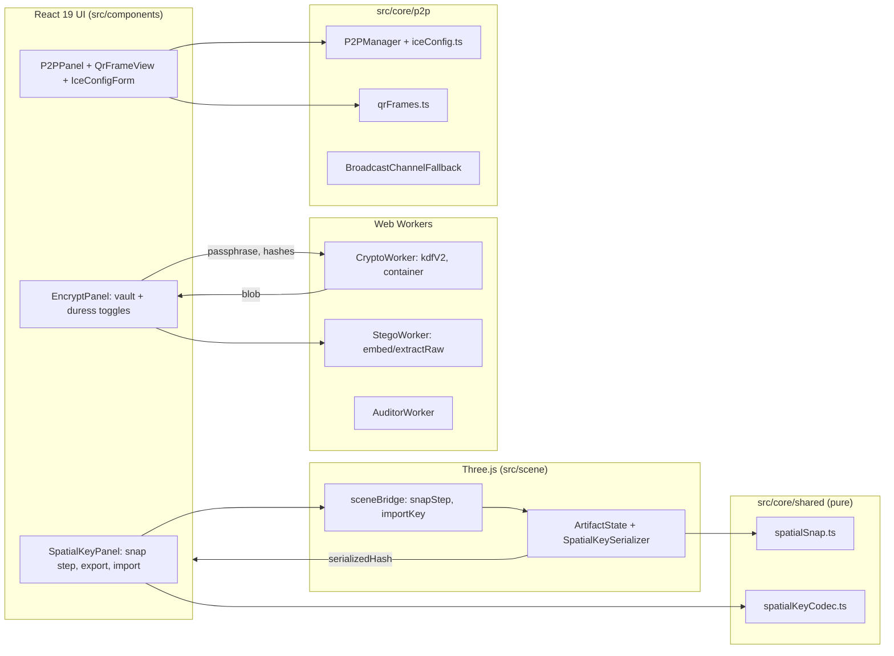

# Design Document

## Overview

Dokumen ini menjabarkan desain teknis untuk rencana 15 hari Kiroween (lihat `requirements.md`). Fokusnya pada hal yang menyentuh kode: Spatial Key (snap kisi, ekspor/impor, kombinasi brankas), Decoy Mode, QR SDP tanpa `data:` URL, konfigurasi ICE, CSP, dan strategi uji. Fase yang berupa dokumen (threat model, README, video, checklist) hanya diberi struktur dan tes validasi ringan.

Temuan dari kode saat ini yang membentuk desain:

| Temuan | Berkas | Dampak |
|---|---|---|
| Salt PBKDF2 deterministik: `SHA-256(passphrase + spatialKeyHash)[0..15]`. Salt tersimpan di blob diabaikan saat decrypt. | `src/core/crypto/KeyDeriver.ts`, `CryptoWorker.ts` | Bertentangan dengan Req 8.3 (salt segar per encrypt). Perlu KDF v2 dengan salt acak, plus fallback v1 untuk carrier lama. |
| Blob tertanam: `iv(12) \| salt(16) \| ciphertext \| tag(16)` di dalam bitstream `magic \| len \| blob \| sha256`. Batas 256 000 byte berlaku pada blob. | `payloadPacking.ts`, `BitstreamLayout.ts` | Mode dekoy ditaruh di dalam blob (kontainer dua slot), sehingga bitstream luar tidak berubah (Req 8.5, 9.6). |
| `StegoWorker` sudah punya op `embedRaw` / `extractRaw` untuk blob mentah. | `StegoWorker.ts` | Kontainer dekoy memakai op ini. Tidak ada op stego baru. |
| `SDPNegotiator.getOfferQRDataURL()` menghasilkan `data:` URL dan `P2PPanel` merendernya lewat ``. CSP `default-src 'self'` memblokirnya (README, known issue). | `SDPNegotiator.ts`, `P2PPanel.tsx`, `vercel.json` | QR digambar ke `<canvas>` dari matriks modul. Tidak melonggarkan CSP. |
| `P2PManager` memakai `new RTCPeerConnection({ iceServers: [] })`. | `P2PManager.ts` | Perlu injeksi `iceServers` lewat konstruktor. |
| CSP diduplikasi di `vercel.json` (header) dan `vite.config.ts` (meta). Keduanya `default-src 'self'; worker-src 'self' blob:`. | `vercel.json`, `vite.config.ts` | Satu sumber nilai CSP plus tes paritas. |
| Download carrier lewat `<a href=blob: download>` sudah dipakai (`DecryptPanel`, `HorcruxShardList`). Anchor download tidak diatur `img-src`. | `DecryptPanel.tsx` | Carrier_Download mengikuti pola yang sama. Jangan pernah merender blob URL lewat ``. |
| `SpatialKeySerializer` menerima sudut float di `[0, 360)` dan cincin integer 0-9. Hash = SHA-256 dari JSON berurutan kunci tetap. | `SpatialKeySerializer.ts` | Snap menghasilkan sudut integer, sehingga bentuk JSON dan hash tetap kompatibel. |

Keputusan arsitektur utama:

1. Semua logika murni baru (snap, codec Spatial Key, KDF v2, kontainer dekoy, framing QR, validasi ICE) berupa fungsi murni tanpa React dan Three.js. Ini membuatnya bisa diuji dengan fast-check dan mematuhi batas lapisan.
2. Kode yang dipakai bersama scene dan komponen ditaruh di `src/core/shared/` (tidak mengimpor React, Three.js, maupun worker).
3. Passphrase dan material kunci hanya ada di `src/core/crypto/`. Scene dan komponen hanya menangani `serializedHash` dan nilai rotasi.

## Architecture



Aliran data berubah pada tiga titik:

- Encrypt: `UI -> CryptoWorker (op encrypt | encryptContainer) -> UI -> StegoWorker (embed | embedRaw)`. Tidak ada pemanggilan worker-ke-worker, sesuai steering.
- Decrypt: `UI -> StegoWorker (extract | extractRaw) -> UI -> CryptoWorker (decrypt | decryptContainer)`.
- Kunci spasial: scene -> `SpatialKeySerializer` -> store (hash). Impor: UI -> `sceneBridge.requestImportedKey()` -> scene menerapkan lalu memancarkan ulang event artefak.

## Components and Interfaces

### Phase 1: Deploy, CSP, QR, Carrier Download

#### CSP dan deploy

Satu modul `src/core/shared/csp.ts` menjadi sumber nilai CSP (string konstan, tanpa impor). `vite.config.ts` mengimpornya untuk meta tag dan header `vite preview`. `vercel.json` tidak bisa mengimpor, jadi tes paritas membandingkan header `vercel.json` dengan konstanta tersebut.

Nilai CSP target (header di Vercel, meta di build; `frame-ancestors` hanya berlaku sebagai header):

```
default-src 'self';
script-src 'self';
style-src 'self';
img-src 'self';
font-src 'self';
connect-src 'self';
media-src 'self';
worker-src 'self' blob:;
object-src 'none';
base-uri 'none';
form-action 'none';
frame-ancestors 'none'
```

Catatan keputusan:

- `img-src 'self'` tanpa `data:` dan tanpa `blob:`. QR dan pratinjau carrier harus lewat `<canvas>`. Ini menutup known issue README.
- `style-src 'self'` memblokir atribut `style=""` dan `<style>` yang di-parse dari HTML. Gaya yang diset lewat CSSOM (`element.style.x = ...`, React `style` prop, Three.js) tidak terkena. Tailwind keluar sebagai berkas CSS. Tugas verifikasi: jalankan Judge Demo di build produksi dengan DevTools dan nol `securitypolicyviolation`.
- `connect-src 'self'` tidak memengaruhi WebRTC. STUN/TURN dan ICE tidak diatur CSP, jadi konfigurasi ICE tidak butuh perubahan CSP.
- Model audit lokal (stretch, Req 17) butuh `'wasm-unsafe-eval'`. Keputusan: tidak ditambahkan ke CSP default. Jika stretch dikerjakan, itu keputusan terpisah yang dicatat di Plan_Tracker. Default: stretch dilepas.
- Header tambahan: `X-Content-Type-Options: nosniff`, `Referrer-Policy: no-referrer` (sudah ada), dan `Permissions-Policy: camera=(self), microphone=(), geolocation=()`. Kamera dibutuhkan hanya untuk pemindaian QR opsional.

Anggaran bundle (Req 2.6): skrip `scripts/check-bundle.mjs` membaca `dist/index.html`, mengumpulkan JS dan CSS awal (entry plus `modulepreload`), menghitung ukuran gzip, dan gagal bila JS awal >= 150 KiB. Dijalankan di CI setelah `npm run build`. Chunk `three`, `p2p`, `p2p-qr`, `worker-*`, `auditor-ml` tetap dinamis (sudah diatur `manualChunks`).

#### QR SDP tanpa `data:` URL

Dua modul baru di `src/core/p2p/` (murni, tanpa crypto, hanya byte dan string):

```ts
// src/core/p2p/qrFrames.ts
export const QR_FRAME_MAGIC = 'CX3Q1';
export const QR_CHUNK_CHARS = 600;   // karakter base64url payload per frame

export interface QrFrame { sid: string; index: number; total: number; chunk: string; }

export type QrFrameErrorCode = 'QR_MALFORMED' | 'QR_CRC' | 'QR_SESSION_MISMATCH' | 'QR_TOTAL_MISMATCH';

/** SDP (LF atau CRLF) -> frame teks. sid = 4 hex dari crypto.getRandomValues. */
export function splitSdp(sdp: string, sid?: string): string[];
/** Satu string frame -> QrFrame, atau melempar QrFrameError dengan kode. */
export function parseFrame(text: string): QrFrame;

export class QrReassembler {
  accept(text: string): { ok: true } | { ok: false; code: QrFrameErrorCode };
  get missing(): number[];      // indeks 0-based yang belum diterima
  get isComplete(): boolean;
  assemble(): string;           // SDP identik dengan masukan splitSdp
}
```

Format frame teks: `CX3Q1.<sid>.<index>.<total>.<base64url chunk>.<crc32 hex8>`. CRC-32 (bukan hash keamanan) hanya mendeteksi salah baca. Integritas terhadap penyerang aktif datang dari DTLS fingerprint di dalam SDP, yang harus diverifikasi lewat saluran yang sama dipercaya pengguna (diatur di Threat_Model_Doc: SDP lewat QR/paste tidak terautentikasi, MITM pada tahap signaling dimungkinkan).

`splitSdp` membawa SDP apa adanya (byte UTF-8, base64url). `assemble()` mengembalikan string identik sehingga `P2PManager.normalizeSdp` tetap satu-satunya tempat normalisasi CRLF. SDP yang muat dalam satu QR tetap dikirim sebagai frame tunggal `total = 1`, sehingga hanya ada satu jalur kode.

Rendering di `src/components/QrFrameView.tsx`:

```ts
import QRCode from 'qrcode';              // dimuat dinamis (chunk p2p-qr)
const qr = QRCode.create(frameText, { errorCorrectionLevel: 'M' });
// qr.modules.size, qr.modules.data (Uint8Array 0/1)
// gambar tiap modul sebagai fillRect integer pada <canvas>; quiet zone 4 modul
```

Tidak ada `toDataURL`, ``, atau blob URL. `SDPNegotiator.getOfferQRDataURL()` dihapus (dan tes yang memakainya diganti). Canvas diberi `role="img"` dan `aria-label`. Warna: modul `#e2e8f0` di atas `#060810` mengikuti steering. Beberapa pemindai butuh kontras gelap-di-atas-terang, jadi tersedia tombol "Invert" yang menukar warna.

UI: frame ditampilkan berurutan dengan kontrol Prev/Next dan penghitung `i / n`, serta auto-advance opsional (default 1,5 detik per frame). Penerima menempelkan teks frame atau memindai. Pemindaian kamera memakai `BarcodeDetector` bila tersedia (tanpa pustaka pihak ketiga); bila tidak, hanya jalur tempel yang aktif dan UI menyebut kapabilitas yang tidak ada (Req 11.2). Daftar frame yang hilang ditampilkan dari `QrReassembler.missing` (Req 3.4). Textarea SDP copy-paste tetap ada di panel yang sama (Req 3.5).

#### Carrier Download

`EncryptPanel` menampilkan tombol Download saat `stegoCarrier` di store tidak kosong. Byte yang diunduh adalah `stegoCarrier` apa adanya (hasil `encodePNG` di `StegoWorker`, `OffscreenCanvas.convertToBlob('image/png')` dari `Uint8ClampedArray` 1024x1024). Tidak ada resize, re-encode, atau konversi ruang warna setelah embed. Nama berkas konstan: `cryptex3d-carrier.png`. Tanpa stegoCarrier, tombol `disabled` dengan label "No embedded carrier". Memakai hook `useBlobUrl` yang sudah ada dan anchor `download`.

Catatan lossless: `encodePNG` memakai `putImageData` lalu `convertToBlob`. Premultiplied alpha bisa mengubah RGB bila alpha < 255 (sudah didokumentasikan di `StegoWorker`). Carrier default opak, dan tes integrasi memverifikasi round trip dekode piksel identik.

### Phase 2: Visual Drama Spec

Tidak ada desain kode di spec ini. Deliverable-nya adalah direktori `.kiro/specs/visual-drama/` (requirements, design, tasks) yang dibuat lewat alur spec terpisah. Batasan yang harus diwarisi spec itu dituliskan di Plan_Tracker: anggaran 4 ms per frame, glow HUD hanya `opacity` dan `filter: blur()`, bloom boleh mati tanpa mematikan efek lain (`adaptiveQuality.ts`), dispose semua resource saat teardown, tekstur carrier tetap `NoColorSpace`/`NearestFilter`/tanpa mipmap.

### Phase 3: Spatial Key

#### Snap kisi

Berkas baru `src/core/shared/spatialSnap.ts` (murni):

```ts
export const SNAP_STEPS = [5, 10, 15, 30, 45, 90] as const;   // semua pembagi 360 yang integer
export type SnapStep = (typeof SNAP_STEPS)[number];
export const DEFAULT_SNAP_STEP: SnapStep = 15;

/** Hasil integer derajat di [0, 360), kelipatan step. Melempar SnapInputError untuk NaN/Infinity. */
export function snapDegrees(deg: number, step: SnapStep): number {
  const d = ((deg % 360) + 360) % 360;
  const n = 360 / step;
  return (Math.round(d / step) % n) * step;     // Math.round: setengah dibulatkan ke atas, deterministik
}

export function snapMonolith(rot: [number, number, number], step: SnapStep): [number, number, number];
export function isOnGrid(deg: number, step: SnapStep): boolean;
```

Keputusan snap:

- Kisi berbasis derajat integer dari himpunan tetap `SNAP_STEPS`. Alasan: sudut hasil snap selalu integer, sehingga `JSON.stringify` di `SpatialKeySerializer.serialize` menghasilkan teks yang sama untuk sudut yang sama di semua mesin (tanpa `45.00000000000001`), dan bentuk JSON legacy tidak berubah.
- Langkah 22,5 derajat dan langkah non-pembagi sengaja tidak ada. Langkah 5 derajat menjaga ruang kunci cukup besar (72^3 = 373 248 orientasi monolit) sambil tetap bisa direproduksi dengan tangan.
- `step` tidak masuk ke hash. Hash hanya mencakup sudut (nilai yang bermakna), sehingga kunci yang dibuat pada kisi 15 tetap terbuka bila pengguna kemudian memakai kisi 5 dan mencapai sudut yang sama. Konsekuensinya: `gridStepDeg` hanya metadata ekspor.
- Cincin sudah diskret (0-9, 36 derajat per langkah) dan tidak ikut snap.
- Snap dijalankan di handler pointer-up artefak (`src/scene/controls/`) sebelum `ArtifactState.setMonolithRot`. Selama drag, scene hanya menghitung `snapDegrees` per frame untuk menggambar panduan: siluet wireframe emisif (warna indigo, HDR < bloom threshold sehingga tidak berpendar) dari pose snap terdekat. Geometri panduan dipakai ulang dari monolit dan material panduan didaftarkan untuk dispose.
- Ganti langkah: HUD memanggil `sceneBridge.setSnapStep(step)` (bridge tetap hanya membawa data tampilan). Scene berlangganan, memanggil `snapMonolith` pada rotasi saat ini, lalu `emit` agar serializer memperbarui hash. Langkah terpilih disimpan di `localStorage` (`cx3.snapStep`, nilai divalidasi terhadap `SNAP_STEPS`, jika tidak valid pakai default).
- `SpatialKeySerializer.serialize` tetap menerima sudut float di `[0, 360)` agar carrier lama (hash dari sudut non-snap) tetap bisa dibuka. Snap diterapkan di sisi scene, bukan sebagai syarat serializer.

Catatan keamanan yang harus masuk Threat_Model_Doc: Spatial Key adalah faktor kedua dengan ruang kunci kecil. Dengan langkah 15 derajat: 24^3 x 10^8 x 2 sekitar 2,8 x 10^12 (sekitar 2^41). Kunci ini tampil di readout HUD dan bisa diekspor, jadi kekuatan utama tetap passphrase dan 310 000 iterasi PBKDF2.

#### Format ekspor/impor Spatial Key

Berkas baru `src/core/shared/spatialKeyCodec.ts` (murni; hanya `crypto.subtle.digest` untuk checksum kode teks):

```ts
export interface SpatialKeyValue {
  gridStepDeg: SnapStep;
  monolithRotationDeg: [number, number, number];   // integer, kelipatan gridStepDeg, [0,360)
  ringSegmentPositions: number[];                  // 8 integer 0..9
  crystalActivated: boolean;
}

export type SpatialKeyImportCode =
  | 'SK_TOO_LARGE' | 'SK_MALFORMED' | 'SK_VERSION_UNSUPPORTED' | 'SK_OFF_GRID' | 'SK_CHECKSUM';

export class SpatialKeyImportError extends Error { readonly code: SpatialKeyImportCode; readonly field?: string; }

export function encodeKeyFile(k: SpatialKeyValue): string;            // JSON kanonik
export function decodeKeyFile(text: string): SpatialKeyValue;         // melempar SpatialKeyImportError
export function encodeKeyCode(k: SpatialKeyValue): Promise<string>;   // "CX3K1-XXXXX-XXXXX-XXXXX-XXXXX"
export function decodeKeyCode(text: string): Promise<SpatialKeyValue>;
export function keyValueEquals(a: SpatialKeyValue, b: SpatialKeyValue): boolean;
```

Dua bentuk dengan makna sama:

1. Berkas JSON `cryptex3d-spatial-key.json` (Req 7.1):

```json
{"format":"cryptex3d.spatial-key","version":1,"gridStepDeg":15,"monolithRotationDeg":[45,90,0],"ringSegmentPositions":[0,1,2,3,4,5,6,7],"crystalActivated":false}
```

   - Urutan kunci tetap, tanpa spasi berlebih. Ukuran maksimum teks yang diterima: 2 048 byte (`SK_TOO_LARGE` sebelum `JSON.parse`).
   - Skema ketat: kunci tak dikenal ditolak (`SK_MALFORMED`), `format` harus tepat, `version` selain 1 menjadi `SK_VERSION_UNSUPPORTED`, `gridStepDeg` harus anggota `SNAP_STEPS`, sudut harus integer di `[0, 360)` dan habis dibagi `gridStepDeg` (jika tidak: `SK_OFF_GRID` dengan `field`), cincin 8 integer 0..9, `crystalActivated` boolean.
   - Tidak ada passphrase, plaintext, hash turunan, atau material kunci. Hash dihitung ulang dari nilai saat diimpor.
   - Pesan error berupa string tetap per kode. Isi berkas tidak pernah ikut dalam pesan.

2. Kode teks (untuk catat tangan atau pesan) `CX3K1-` diikuti 20 karakter Crockford base32 dalam 4 grup lima karakter. Payload 12 byte:

   | Byte | Isi |
   |---|---|
   | 0 | versi (0x01) |
   | 1 | `gridStepDeg / 5` |
   | 2-4 | indeks langkah monolit X, Y, Z (`sudut / gridStepDeg`, 0..71) |
   | 5-8 | 8 nibble posisi cincin |
   | 9 | bit 0 = crystalActivated, bit lain harus 0 |
   | 10-11 | 2 byte pertama `SHA-256(byte 0..9)` |

   Pengurai: hapus spasi dan tanda hubung, ubah ke huruf besar, petakan `I,L -> 1` dan `O -> 0`, tolak `U`, tolak bit sisa non-nol di karakter terakhir (bentuk kanonik), lalu cek versi, langkah, jangkauan, dan checksum 16 bit. Checksum ini hanya mendeteksi salah ketik, bukan perlindungan keamanan.

Alur UI (`SpatialKeyPanel`, di dalam `SpatialKeyDisplay`/dock): tombol Export menulis berkas lewat Blob anchor dan menampilkan kode teks di `<pre>` monospace; kolom Import menerima tempel (JSON atau kode) atau berkas (`<input type="file" accept=".json,application/json">`). Hasil impor valid diteruskan ke scene lewat `sceneBridge.requestImportedKey(value)`, yang menerapkan nilai ke `ArtifactState` lalu `emit`. Peringatan teks fungsional di UI: berkas kunci adalah faktor rahasia dan sebaiknya disimpan terpisah dari carrier dan passphrase.

#### Kombinasi brankas (Vault Combination)

Perubahan di `src/core/crypto/` (tanpa pustaka baru, Web Crypto saja):

```ts
// src/core/crypto/kdfV2.ts
export const KDF_V2_LABEL = 'CX3-KDF-v2';
export const MAX_VAULT_KEYS = 4;

/** Urutan kanonik: hash heksadesimal diurutkan leksikografis; duplikat ditolak. */
export function canonicalFactors(hashes: readonly string[]): string[];

/** Salt PBKDF2 32 byte = SHA-256(label \0 | randomSalt(16) | u8 count | untuk tiap hash: u16 len | ASCII). */
export async function composeSalt(randomSalt: Uint8Array, hashes: readonly string[]): Promise<Uint8Array>;

export async function deriveKeyV2(
  passphrase: string,
  randomSalt: Uint8Array,        // 16 byte, acak per encrypt, disimpan di blob
  keyHashes: readonly string[],  // 1..MAX_VAULT_KEYS
): Promise<CryptoKey>;           // PBKDF2-SHA-256, 310 000 iterasi, AES-GCM 256, non-extractable
```

Keputusan:

- Kata sandi PBKDF2 tetap passphrase. Salt PBKDF2 mencakup salt acak 16 byte dan seluruh hash Spatial Key, sehingga steering "salt memuat passphrase dan Spatial Key" terpenuhi secara fungsional: salah satu faktor salah menghasilkan kunci AES berbeda dan tag GCM gagal, bukan dekripsi diam-diam yang salah. (Salt v1 memuat passphrase di input hash; pada v2 passphrase berada di kata sandi PBKDF2 dan tidak perlu diulang di salt. Perubahan ini dicatat di Threat_Model_Doc.)
- Urutan faktor kanonik dengan pengurutan hash. Pengguna tidak perlu mengingat urutan, dan dokumentasi tinggal menyebut "diurutkan leksikografis". Jumlah faktor dan panjang tiap hash masuk ke digest dengan awalan panjang agar tidak ada ambiguitas penggabungan.
- Satu PBKDF2 per operasi, berapa pun jumlah kunci (K antara 1 dan 4). Biaya tidak naik dengan K.
- Salt acak 16 byte baru dan IV 12 byte baru setiap `encrypt`. Salt disimpan di slot salt blob yang sudah ada (`payloadPacking`), tanpa perubahan layout.
- Dekripsi mode tunggal: coba v2; bila `AuthFailError`, coba v1 (`deriveKey` lama dengan salt deterministik) untuk carrier yang dibuat versi sebelumnya. Kedua jalur tetap memverifikasi tag penuh 128 bit. Jalur kontainer (di bawah) tidak pernah memakai v1.
- Wire: `EncryptRequestPayload` dan `DecryptRequestPayload` mendapat `keyHashes?: string[]` (bila ada, menggantikan `spatialKeySnapshot.serializedHash`). Hanya string hash yang melewati batas worker, tidak ada sudut atau passphrase di luar worker kripto.
- UI: panel Encrypt/Decrypt punya daftar "Key slots" (1-4). Tiap slot diisi dengan menangkap hash Spatial Key saat ini (`captureSlot`). Slot tersimpan di store sebagai hash saja dan dihapus saat reset. Slot ganda dengan hash sama ditolak (`INVALID_INPUT`).
- Batas ukuran tetap: blob > 256 000 byte memicu `PayloadTooLargeError` dari `LSBEmbedder` sebelum piksel disentuh (fungsi `embed` membuat salinan, input tak pernah dimutasi).

#### Decoy Mode (kontainer dua slot)

Tujuan: pengguna di bawah tekanan dapat membuka satu rahasia umpan tanpa bukti kriptografis bahwa ada rahasia kedua yang nyata, dan tanpa mengurangi jaminan GCM.

Prinsip desain yang tidak boleh dilanggar:

1. Setiap slot adalah enkripsi AES-256-GCM penuh dengan tag 128 bit, IV acak sendiri, salt acak sendiri, dan kunci turunan sendiri. Tidak ada kunci, IV, atau salt yang dipakai bersama antar slot. Tidak ada jalur yang melewati verifikasi tag.
2. Ukuran slot sama. Kerja kripto per percobaan decrypt konstan. Bentuk error sama untuk semua kegagalan.
3. Slot kedua selalu ada di setiap kontainer. Tanpa umpan, slot itu berisi byte acak CSPRNG yang secara statistik tak dapat dibedakan dari ciphertext asli.

Layout kontainer (isi blob yang dibungkus bitstream `magic | len | blob | sha256` tanpa perubahan):

```
container = slot0 || slot1
slot      = iv(12) || salt(16) || ciphertext(P) || tag(16)       ; ukuran 44 + P
plaintext = u32be(dataLen) || data || zeros(P - 4 - dataLen)     ; panjang tepat P
data      = wrapPayload(payload, expiresAt?)                     ; envelope TTL yang ada
```

`P` dipilih dari bucket `[1024, 4096, 16384, 65536, 127956]` sebagai bucket terkecil yang memuat `4 + max(len(real'), len(decoy'))` (len' sudah termasuk envelope TTL bila ada). Batas atas `127956` berasal dari `2 * (44 + P) <= 256000`. Input yang tidak muat melempar `PayloadTooLargeError` (kode `PAYLOAD_TOO_LARGE`) di worker kripto sebelum embed (Req 9.5). Panjang kontainer hanya bergantung pada bucket, sehingga tidak membocorkan slot mana yang lebih besar. Bucket sendiri membocorkan ukuran kasar, dan ini dicatat di threat model.

Modul baru `src/core/crypto/decoyContainer.ts`:

```ts
export const CONTAINER_BUCKETS = [1024, 4096, 16384, 65536, 127956] as const;

export interface SlotCredentials { passphrase: string; keyHashes: string[]; }

export function bucketFor(maxDataLen: number): number;                       // throws PayloadTooLargeError
export function isContainerShape(blobLen: number): boolean;                 // blobLen === 2 * (44 + P)

export async function sealContainer(
  real: { payload: Uint8Array; creds: SlotCredentials; expiresAt?: number },
  decoy: { payload: Uint8Array; creds: SlotCredentials } | null,           // null -> slot filler acak
  rng?: (n: number) => Uint8Array,                                          // default crypto.getRandomValues
): Promise<Uint8Array>;

export async function openContainer(
  blob: Uint8Array,
  creds: SlotCredentials,
  hooks?: { onKdf?: () => void; onGcm?: () => void },                       // hanya untuk tes jumlah operasi
): Promise<Uint8Array>;                                                      // melempar AuthFailError tunggal
```

Langkah `sealContainer`:

1. Tolak bila `decoy` ada dan kredensialnya sama dengan `real` (passphrase sama dan himpunan hash sama): `INVALID_INPUT`. Pemeriksaan ini hanya di encrypt, tidak ada hubungannya dengan percobaan decrypt.
2. Tentukan `P`. Bentuk plaintext berpadding untuk kedua slot (slot filler tidak butuh plaintext).
3. Tentukan indeks slot asli `r` dari satu bit `crypto.getRandomValues` (acak per embed). Slot umpan menempati slot lain.
4. Untuk tiap slot nyata: salt acak 16 byte, IV acak 12 byte, `deriveKeyV2`, `encryptDetached`, rakit `iv|salt|ct|tag`. Slot filler: `44 + P` byte acak.
5. Hapus plaintext berpadding (`fill(0)`).

Langkah `openContainer` (kerja konstan):

1. Pecah `blob` menjadi dua slot sama panjang. Bila bukan bentuk kontainer, lempar `AuthFailError` (bentuk ini tak akan sampai ke sini karena pemilihan jalur di `CryptoWorker`, lihat di bawah).
2. Untuk slot 0 lalu slot 1, tanpa early exit dan tanpa paralel yang bisa berhenti lebih awal: `deriveKeyV2(creds, slot.salt)` lalu `decrypt`. Hasil disimpan sebagai `{ok, plain}`. Selalu tepat 2 PBKDF2 dan 2 dekripsi GCM.
3. Setelah kedua slot selesai: bila `ok0` kembalikan slot 0; elif `ok1` kembalikan slot 1; selain itu lempar satu `AuthFailError`. Plaintext slot yang tidak dipilih di-`fill(0)`.
4. Validasi `dataLen <= P - 4` setelah tag terverifikasi; jika tidak, perlakukan sebagai `AuthFailError`.

Jawaban terhadap permintaan "jangan bocorkan lewat timing, ukuran, error":

| Saluran | Tindakan |
|---|---|
| Timing | Selalu 2 PBKDF2 + 2 GCM per percobaan, urutan tetap, tanpa early exit. Perbedaan sisa (menyalin/unpad plaintext) hanya terjadi pada percobaan yang berhasil, yang hanya dilihat pemegang kredensial. Diuji lewat penghitung operasi (`hooks`), bukan jam dinding. |
| Ukuran | Dua slot sama besar, bucket dipilih dari maksimum kedua panjang. Panjang kontainer tidak bergantung pada ada-tidaknya umpan atau slot mana yang asli. |
| Posisi | Slot asli dipilih acak per embed dan tidak disimpan. |
| Error | Semua kegagalan kripto memakai satu kode `AUTH_FAIL` dan satu pesan `Authentication failed`. Kegagalan stego (`BAD_MAGIC`, `CHECKSUM_FAIL`) terjadi sebelum kripto dan tidak bergantung pada kredensial. Pesan `EXPIRED` hanya terjadi setelah tag terverifikasi (hanya pemegang kredensial yang sah dapat melihatnya). |
| Isi slot filler | Byte acak CSPRNG, bentuk sama dengan slot nyata. |
| Kredensial sama | Ditolak saat encrypt agar tidak ada ambiguitas hasil. |

Pemilihan jalur di `CryptoWorker` untuk decrypt: `decrypt` (mode tunggal) tetap menerima `{iv, salt, ciphertext, tag}` hasil `unpackPayload`. Untuk kontainer, pipeline memakai op baru `decryptContainer` yang menerima blob mentah dari `extractRaw`. Pemilihan jalur dilakukan di pipeline runner berdasarkan `isContainerShape(blob.length)`:

- Pipeline memanggil `stego.extractRaw` (bukan `extract`) untuk semua decrypt, lalu memilih: kontainer bila `isContainerShape`, jika tidak `unpackPayload` + `decrypt` tunggal.
- Agar mode tunggal tidak pernah kebetulan berbentuk kontainer, `encrypt` tunggal membungkus payload dengan envelope TTL `expiresAt = 0` (tambah 16 byte) bila blob hasilnya akan memenuhi `isContainerShape`. Selisih bucket jauh lebih besar dari 16 byte, jadi satu kali pembungkusan cukup. Ini memakai mekanisme `wrapPayload` yang sudah ada.

Pembatasan jujur yang dimasukkan ke Threat_Model_Doc (Req 15.5): (a) keberadaan kontainer terlihat dari panjang dan format bagi pihak yang mengetahui program ini, sehingga yang disembunyikan hanyalah apakah slot kedua berisi rahasia; (b) tidak ada klaim penyangkalan terhadap pihak yang memaksa semua kredensial atau melihat memori; (c) bucket membocorkan ukuran kasar; (d) umpan yang tidak meyakinkan melemahkan manfaatnya; (e) steganografi tidak menyembunyikan keberadaan data dari adversari statistik.

Antarmuka UI: toggle "Duress container" pada `EncryptPanel`. Saat aktif muncul bagian kedua dengan payload umpan, passphrase umpan, dan slot Spatial Key umpan (opsional; boleh sama dengan kunci asli asalkan passphrase berbeda). Teks UI bersifat fungsional. Decrypt panel tidak berubah: pengguna memasukkan satu set kredensial, dan hasilnya payload slot yang cocok.

### Phase 4: ICE dan Lintas Browser

Modul murni `src/core/p2p/iceConfig.ts`:

```ts
export interface IceServerEntry { urls: string; username?: string; credential?: string; }
export type IceMode = 'default' | 'custom' | 'local';
export interface IceConfig { version: 1; mode: IceMode; servers: IceServerEntry[]; }

export const DEFAULT_ICE_SERVERS: readonly IceServerEntry[] = [{ urls: 'stun:stun.l.google.com:19302' }];
export const MAX_ICE_SERVERS = 8;

export interface IceValidationIssue { field: string; code: 'ICE_SCHEME' | 'ICE_HOST' | 'ICE_PORT' | 'ICE_CREDENTIALS' | 'ICE_COUNT'; }

export function validateIceConfig(input: unknown): { ok: true; value: IceConfig } | { ok: false; issues: IceValidationIssue[] };
export function toRtcConfiguration(cfg: IceConfig): RTCConfiguration;   // 'local' -> iceServers: []
export function redactIceConfig(cfg: IceConfig): unknown;               // username/credential diganti '***'
```

Aturan:

- Skema URL yang diterima: `stun:`, `stuns:`, `turn:`, `turns:`. Bentuk `skema:host[:port][?transport=udp|tcp]`; host non-kosong, tanpa spasi, maksimum 253 karakter; port 1-65535. Satu `urls` per entri (string tunggal) agar `field` pada error menunjuk entri tertentu, misalnya `servers[2].urls`.
- Entri `turn`/`turns` wajib memiliki `username` dan `credential`; entri `stun`/`stuns` tidak boleh memilikinya (`ICE_CREDENTIALS`, `field` menyebut kolom).
- Maksimum 8 entri. Mode `default` memakai `DEFAULT_ICE_SERVERS` (Req 10.5; dokumentasikan di README bahwa STUN publik melihat alamat IP publik pengguna). Mode `local` memakai `iceServers: []`, yaitu perilaku sekarang, untuk pengguna yang menolak STUN pihak ketiga.
- Persistensi di `src/components/iceConfigStorage.ts` (lapisan UI/state, bukan lapisan P2P): kunci `localStorage` `cx3.ice.v1`, JSON dari `IceConfig`. Pembacaan lewat `validateIceConfig`; data rusak diabaikan dan diganti default tanpa melempar. Kredensial TURN tersimpan teks biasa di `localStorage` karena Req 10.2 mewajibkan persistensi. Risiko ini (skrip same-origin bisa membaca) dicatat di threat model dan dimitigasi CSP `script-src 'self'`.
- Penyaringan log: `P2PManager` tidak pernah menerima atau mencetak objek konfigurasi mentah dalam pesan error. `P2PError` hanya memuat kode dan teks tetap. Tampilan konfigurasi di UI memakai `redactIceConfig`. SDP tidak memuat kredensial TURN, hanya kandidat. Kolom `credential` memakai `type="password"` dan font mono.
- Injeksi: `new P2PManager({ iceServers })` menggantikan literal `{ iceServers: [] }`; `P2PPanel` membaca konfigurasi tersimpan lewat store dan memberi `toRtcConfiguration(cfg).iceServers`.
- Fallback: logika `BroadcastChannelFallback.autoActivate` dan `isWebRTCAvailable()` yang ada dipertahankan (Req 10.6). Tambahan: ketika event `iceTimeout` atau `statechange = failed` terjadi, `P2PPanel` menampilkan status dan mengaktifkan fallback otomatis (`switchToBroadcast` sudah ada untuk kasus WebRTC tidak tersedia). Pengujian: stub `RTCPeerConnection = undefined` dan verifikasi pemilihan transport.
- `P2PManager` tetap hanya memindahkan byte mentah (Req 10.7).

Cross-browser: `docs/cross-browser-checklist.md` berisi matriks Chrome, Firefox, Edge, Safari x {encrypt, embed, download, extract, decrypt, P2P, QR, snap/export/import, decoy}, dengan kolom hasil, tanggal, dan masalah diketahui. Pemeriksaan kapabilitas di `src/core/shared/capabilities.ts` (`crypto.subtle`, `OffscreenCanvas`, `RTCPeerConnection`, `BroadcastChannel`, `BarcodeDetector`) mengembalikan daftar nama kapabilitas yang hilang untuk pesan UI (Req 11.2). Risiko diketahui: `OffscreenCanvas.convertToBlob` di Safari lama; mitigasi: deteksi kapabilitas dan pesan yang menyebut kapabilitas tersebut.

### Phase 5: Guided Tour, Tripwire, Judge Demo

Guided Tour: reducer murni `src/components/tourReducer.ts` dengan state `{ active, index, completed }`, aksi `start | next | back | skip | finish`, dan daftar langkah tetap (Command Dock, Spatial Key readout, Zen toggle, Judge Demo). `index` selalu di `[0, steps.length - 1]`. Komponen `GuidedTour.tsx` menggambar kartu kaca kecil berdekatan dengan elemen target (menggunakan `getBoundingClientRect` target lewat `data-tour` atribut, bukan `document.querySelector` di luar akar React: ref dikumpulkan melalui konteks React). Luas kartu dibatasi agar tidak menutup lebih dari 40% kanvas. Flag selesai/lewati disimpan di `localStorage` (`cx3.tour.v1`).

Tripwire Scenario: modul murni `src/core/stego/tamper.ts`:

```ts
/** Membalik LSB (kanal R,G,B) pada setiap n-th bit di dalam extent payload, mulai setelah header 96 bit. */
export function flipLsbFraction(pixels: Uint8ClampedArray, extentBits: number, fraction: number): { pixels: Uint8ClampedArray; flipped: number };
```

- Deterministik (pencacah langkah `n = round(1 / fraction)`, tanpa `Math.random`), sehingga uji bisa dihitung persis. Mulai setelah `HEADER_SIZE * 8` bit supaya kegagalan yang muncul adalah `CHECKSUM_FAIL` dan bukan `BAD_MAGIC` (Req 13.3).
- Skenario: carrier penutup terstruktur dan deterministik (fungsi baru di `carrierGenerator.ts`, gradien halus bidang LSB rendah) -> audit "bersih" -> embed -> ubah fraksi -> audit "ditandai" -> ekstraksi menampilkan `CHECKSUM_FAIL`. Carrier derau bawaan tidak dipakai, karena bidang LSB-nya sudah acak sehingga audit statistik tidak membedakan sebelum dan sesudah. Risiko: ambang `HeuristicScorer` harus dikalibrasi terhadap carrier fixture; tes contoh memastikan verdict "clean" pra-embed dan "flagged" pasca-embed+tamper pada fixture. Bila kalibrasi gagal, tugas yang bersangkutan menyesuaikan ukuran payload skenario, bukan ambang auditor.
- Auditor tetap di Web Worker, hanya menasihati, dan tidak memblokir embed/extract. Tidak ada panggilan jaringan.

Judge Demo: `runDemo(deps)` mendapat `options.signal?: AbortSignal`. Tombol Cancel di `DemoModeOrchestrator` memanggil `abort()`, yang menutup kanal (`closeChannels` yang sudah ada), membatalkan timer, dan men-terminate worker lewat `WorkerManager`. Pesan error melewati `errorSanitizer.ts` yang sudah ada.

### Phase 6: Dokumen dan Pengiriman

Plan_Tracker disimpan sebagai `plan-tracker.md` di direktori spec ini, berupa tabel Markdown:

| Kolom | Isi |
|---|---|
| Day | 1-15 |
| Phase | 1-6 atau `buffer` |
| Deliverable | nama |
| Done-condition | kondisi terverifikasi |
| Status | `planned`, `done`, `carried-over`, `descoped` |
| Verified | tanggal dan hasil |

Pemetaan hari yang diusulkan: hari 1-2 Fase 1; hari 3 Fase 2; hari 4-7 Fase 3; hari 8-9 Fase 4; hari 10-11 Fase 5; hari 12-14 Fase 6 (freeze di awal hari 13, hash commit freeze dicatat); hari 15 buffer tanpa pekerjaan fitur. Stretch (model audit lokal) berada di hari 12 dan dapat dilepas tanpa memengaruhi deliverable lain.

Dokumen lain: `docs/threat-model.md` (aset, adversari, batas kepercayaan, permukaan serang, mitigasi dengan tautan ke berkas/tes, batasan, parameter kripto), `docs/evidence.md` (keluaran `vitest --run`, tanggal, pemetaan spec/steering/hook ke fitur atau cacat), README (deskripsi, URL, perintah, arsitektur, ringkasan keamanan, penggunaan Kiro), `docs/video-script.md` (maksimum 3 menit, segmen bertempo), `docs/submission-checklist.md`. Skrip `scripts/check-doc-links.mjs` memeriksa bahwa setiap path berkas yang dirujuk di dokumen ada.

Model audit lokal (stretch): tetap `auditor-ml` chunk dinamis yang dimuat atas permintaan pengguna di dalam `AuditorWorker`. Kegagalan memuat mengembalikan laporan heuristik dengan penanda `modelUnavailable`. Karena butuh `'wasm-unsafe-eval'` pada CSP, default dilepas (lihat bagian CSP).

## Data Models

```ts
// Snapshot yang sudah ada (src/store/types.ts); tidak berubah
interface SpatialKeySnapshot {
  monolithRotationX: number; monolithRotationY: number; monolithRotationZ: number;
  ringSegmentPositions: number[]; crystalActivated: boolean; serializedHash: string;
}

// Tambahan di store (hanya hash dan metadata, tanpa passphrase)
interface VaultSlotsState {
  keySlots: { id: string; hash: string }[];     // 0..4, urutan kanonik dibuat di worker
  snapStep: SnapStep;
  decoyEnabled: boolean;
}

// Pesan worker kripto (tambahan; field lama tidak berubah)
interface EncryptContainerRequest {
  real: { payload: Uint8Array; passphrase: string; keyHashes: string[]; expiresAt?: number };
  decoy: { payload: Uint8Array; passphrase: string; keyHashes: string[] } | null;
}
interface EncryptContainerResponse { blob: Uint8Array }
interface DecryptContainerRequest { blob: Uint8Array; passphrase: string; keyHashes: string[] }
interface DecryptContainerResponse { plaintext: Uint8Array; expiresAt?: number }
```

Layout biner ringkas:

```
Bitstream luar (tidak berubah): MAGIC(8) | len(4, BE) | blob | SHA-256(MAGIC|len|blob)(32)
Blob tunggal v2 (layout tidak berubah): iv(12) | salt(16, acak) | ct(N) | tag(16)
Blob kontainer: slot0 | slot1, slot = iv(12) | salt(16) | ct(P) | tag(16)
Salt PBKDF2 v2 (32 byte): SHA-256("CX3-KDF-v2\0" | salt16 | u8 K | K x (u16 len | hash ASCII terurut))
```

Penyimpanan lokal: `cx3.snapStep`, `cx3.ice.v1`, `cx3.tour.v1`. Tidak ada rahasia selain kredensial TURN opsional di `cx3.ice.v1`.

## Error Handling

| Situasi | Kode | Penanganan |
|---|---|---|
| Passphrase di luar 8-64 karakter | `INVALID_PASSPHRASE` | Tetap seperti sekarang |
| Tag GCM gagal, faktor Spatial Key salah/hilang, kredensial kontainer tidak cocok | `AUTH_FAIL` | Satu kode dan satu pesan untuk semua penyebab |
| Blob > 256 000 byte atau di luar bucket terbesar | `PAYLOAD_TOO_LARGE` | Dilempar sebelum embed; piksel tak dimodifikasi |
| Carrier terlalu kecil | `CARRIER_CAPACITY_EXCEEDED` | Seperti sekarang |
| Magic salah / checksum salah | `BAD_MAGIC` / `CHECKSUM_FAIL` | Terlihat oleh pengguna, sebelum kripto |
| Kredensial decoy sama dengan asli, hash kunci duplikat, K di luar 1..4 | `INVALID_INPUT` | Hanya saat encrypt |
| Berkas/kode Spatial Key tidak valid | `SK_*` | Kode tetap dan pesan tetap; isi masukan tidak disalin ke pesan |
| Frame QR rusak / sesi berbeda | `QR_*` | Daftar indeks yang hilang ditampilkan |
| Entri ICE tidak valid | `ICE_*` + `field` | Kolom yang bersalah disebut, nilai tidak dicetak |
| `RTCPeerConnection` tidak ada | `WEBRTC_UNAVAILABLE` | Aktifkan `BroadcastChannel` otomatis |
| Capability hilang | nama kapabilitas | Pesan UI menyebut kapabilitas |
| Error tak terduga di worker | `INTERNAL` | Pesan generik; `e.message` tidak pernah diteruskan |

Aturan lintas-bagian: tidak ada `console.*` pada jalur crypto/stego/auditor yang memuat plaintext, passphrase, hash kunci, atau byte kunci; hanya nama operasi, panjang byte, dan kode. Buffer plaintext sementara dihapus dengan `fill(0)` setelah dipakai (pola yang sudah ada di `CryptoWorker`).

## Testing Strategy

Alat: Vitest 5 (`tests/**/*.test.ts`, lingkungan Node, `crypto.subtle` tersedia) dan fast-check 4. Penempatan mengikuti direktori yang ada: `tests/property/` untuk properti, `tests/unit/` untuk contoh, `tests/integration/` untuk alur lintas modul.

Pendekatan ganda:

- Tes properti fast-check untuk semua fungsi murni dan alur kripto round trip. Minimum 100 iterasi untuk fungsi murni (snap, codec, framing, ICE, tamper, tour reducer, validator jadwal).
- Operasi dengan PBKDF2 310 000 iterasi (round trip kripto, kegagalan faktor salah, kontainer) memakai `numRuns` kecil (10 sampai 20) dengan `testTimeout` 30 detik yang sudah dikonfigurasi. Iterasi tidak boleh dikurangi untuk tes (menjaga parameter produksi). Properti komposisi salt (`composeSalt`, `canonicalFactors`) murni dan cepat, sehingga dijalankan 100+ kali.
- Tes contoh: nilai CSP paritas `vercel.json` dan `vite.config.ts`, konstanta KDF (310 000, SHA-256, AES-GCM 256), STUN default, status tombol download tanpa carrier, nama berkas download, fallback `BroadcastChannel` saat `RTCPeerConnection` undefined, urutan lima langkah Judge Demo dan pembersihan saat cancel (dengan `DemoDeps` palsu), kalibrasi Tripwire pada fixture.
- Tes smoke: batas impor (grep dalam tes) bahwa `src/scene/` dan `src/components/` tidak mengimpor `src/core/crypto/` dan tidak menyentuh passphrase, `src/core/p2p/` tidak mengimpor `crypto/` atau `stego/`, tidak ada pustaka kripto pihak ketiga di `package.json`, `scripts/check-bundle.mjs` lulus pada `dist`.
- Hygiene log: tes menyadap `console.*` selagi menjalankan encrypt/decrypt/embed/extract/audit dengan passphrase dan payload acak, lalu memastikan tak ada string rahasia atau hex hash kunci pada keluaran (Req 16.6).
- Tes jumlah operasi untuk dekoy: `hooks.onKdf` dan `hooks.onGcm` menghitung operasi. Properti mensyaratkan hitungan yang sama untuk kredensial asli, kredensial umpan, dan kredensial salah (bukan pengukuran jam dinding yang tidak stabil).

Format tag untuk tiap tes properti: `Feature: kiroween-winning-plan, Property N: <teks properti>`.

Generator utama: sudut `fc.double({min: -1e6, max: 1e6, noNaN: true})`, langkah `fc.constantFrom(...SNAP_STEPS)`, `SpatialKeyValue` valid (indeks langkah lalu kalikan dengan step), cincin `fc.array(fc.integer({min:0,max:9}), {minLength:8,maxLength:8})`, SDP `fc.string` dengan karakter ASCII cetak dan baris, payload `fc.uint8Array({maxLength: 2048})`, passphrase `fc.string({minLength:8,maxLength:64})`, hash `fc.stringMatching(/^[0-9a-f]{64}$/)` (fast-check 4 tidak punya `hexaString`).

## Correctness Properties

*A property is a characteristic or behavior that should hold true across all valid executions of a system-essentially, a formal statement about what the system should do. Properties serve as the bridge between human-readable specifications and machine-verifiable correctness guarantees.*

Refleksi redundansi: properti pembulatan (6.1) dan panduan visual (6.3) memakai fungsi yang sama sehingga digabung. Properti round trip ekspor/impor untuk berkas dan kode teks digabung dengan whitelist isi berkas (7.1, 7.2, 7.4). Properti "salt segar" (8.3) dipertahankan terpisah dari komposisi salt karena memeriksa hasil `encrypt` nyata. Properti tamper untuk checksum (9.6, 13.3) digabung menjadi satu. Properti kegagalan faktor salah pada mode tunggal dan vault (6.5, 8.2) digabung. Ketidakterbedaan error dekoy (9.4) dan konstansi kerja digabung karena keduanya dibuktikan pada himpunan kredensial yang sama.

### Property 1: Snap menghasilkan titik kisi terdekat

For any finite angle in degrees and any step in `SNAP_STEPS`, `snapDegrees` returns an integer in `[0, 360)` that is a multiple of the step, whose circular distance from the normalized input is at most `step / 2` (with a 1e-9 tolerance), and `snapDegrees(snapDegrees(x, s), s)` equals `snapDegrees(x, s)`.

**Validates: Requirements 6.1, 6.3**

### Property 2: Serialisasi Spatial Key kanonik

For any two monolith rotation triples that snap to the same grid points (including inputs differing by multiples of 360 degrees), and the same ring positions and crystal flag, `SpatialKeySerializer.serialize` after snapping yields identical `serializedHash` and identical JSON bytes.

**Validates: Requirements 6.2**

### Property 3: Re-snap pada langkah baru

For any snapped Spatial Key and any new step in `SNAP_STEPS`, re-snapping yields rotations that are on the new grid and equal `snapDegrees` of the previous rotations at the new step.

**Validates: Requirements 6.4**

### Property 4: Round trip ekspor/impor Spatial Key

For any valid `SpatialKeyValue`, `decodeKeyFile(encodeKeyFile(k))` and `await decodeKeyCode(await encodeKeyCode(k))` both equal `k`, and the exported file contains only the whitelisted keys (`format`, `version`, `gridStepDeg`, `monolithRotationDeg`, `ringSegmentPositions`, `crystalActivated`).

**Validates: Requirements 7.1, 7.2, 7.4**

### Property 5: Impor menolak berkas tidak valid dengan kode

For any valid exported file or code mutated by one of: unknown version, unknown or missing key, wrong value type, angle off the grid, ring value outside 0..9, wrong ring length, oversized text, or altered code checksum, the decoder throws `SpatialKeyImportError` with the code matching the mutation and never throws any other error type nor includes input text in the message.

**Validates: Requirements 7.5**

### Property 6: Komposisi salt KDF v2

For any random salt and any set of key hashes, `composeSalt` returns 32 bytes, gives the same result for every permutation of the hashes, and gives a different result when any hash is changed, added, or removed, or when the random salt changes.

**Validates: Requirements 6.5, 8.1**

### Property 7: Round trip enkripsi/dekripsi

For any payload, valid passphrase, and set of 1 to 4 distinct key hashes, decrypting the output of encrypt with the same passphrase and the same hashes (in any order) returns the original payload, and the legacy v1 path still opens a blob created with the v1 derivation.

**Validates: Requirements 8.1, 16.2**

### Property 8: Faktor yang salah atau hilang gagal terautentikasi

For any encrypted payload and any single change to the credentials (a different passphrase, a changed key hash, a missing key hash, or an extra key hash), decryption fails with `AUTH_FAIL` and returns no plaintext.

**Validates: Requirements 6.5, 8.2**

### Property 9: IV dan salt segar per enkripsi

For any payload and credentials, encrypting N times yields N pairwise distinct IVs of 12 bytes and N pairwise distinct salts of at least 16 bytes, with the PBKDF2 parameters equal to SHA-256 and 310 000 iterations.

**Validates: Requirements 8.3, 8.4**

### Property 10: Round trip embed/extract dan bitstream tidak berubah

For any ciphertext blob up to the capacity of the carrier and any carrier pixel buffer, `extract(embed(carrier, blob))` returns the blob, the bitstream begins with the 8-byte magic and a big-endian length equal to the blob length, ends with SHA-256 of the preceding bytes, and the input carrier buffer is not mutated.

**Validates: Requirements 4.3, 8.5**

### Property 11: Payload melebihi batas ditolak sebelum piksel berubah

For any blob larger than 256 000 bytes, `embed` throws `PayloadTooLargeError` and the carrier buffer is byte-identical to its prior state; for any decoy plus real input that does not fit the largest bucket, `sealContainer` throws `PayloadTooLargeError` before any stego call.

**Validates: Requirements 8.6, 9.5**

### Property 12: Perubahan bit pada bitstream terdeteksi

For any embedded carrier and any single LSB flipped inside the payload extent after the 12-byte header, extraction throws `ChecksumFailError`, and for any flipped bit inside the magic it throws `BadMagicError`; extraction never returns data after any such flip.

**Validates: Requirements 9.6, 13.3**

### Property 13: Kredensial dekoy hanya membuka slot masing-masing

For any distinct real and decoy payloads and any two different credential sets, `openContainer` with the decoy credentials returns exactly the decoy payload and with the real credentials returns exactly the real payload, regardless of which slot index holds the real payload.

**Validates: Requirements 9.1, 9.2, 9.3**

### Property 14: Kegagalan kontainer tidak dapat dibedakan dan kerja konstan

For any container (with or without a decoy) and any credential set matching neither slot, `openContainer` throws an error whose code and message equal those of every other failing credential set, and for every credential set (matching real, matching decoy, or matching neither) the number of KDF derivations is exactly 2 and the number of GCM decryptions is exactly 2.

**Validates: Requirements 9.4**

### Property 15: Ukuran kontainer tidak membocorkan slot asli

For any pair of payload lengths whose padded bucket is the same, the container produced has the same byte length whether or not a decoy is supplied, and whichever payload is longer; and the container length always equals `2 * (44 + P)` for a bucket `P` in `CONTAINER_BUCKETS`.

**Validates: Requirements 9.5, 9.1**

### Property 16: Mode tunggal tidak pernah berbentuk kontainer

For any payload, single-slot encryption produces a blob for which `isContainerShape` is false.

**Validates: Requirements 9.4**

### Property 17: Round trip frame QR

For any SDP string and any delivery order of its frames with arbitrary duplicates, `QrReassembler` reaches completion and `assemble()` returns a string equal to the original SDP, with every frame text parseable and every chunk at most `QR_CHUNK_CHARS` characters.

**Validates: Requirements 3.1, 3.2, 3.3**

### Property 18: Frame yang hilang atau rusak dilaporkan

For any SDP split into frames, removing any non-empty subset makes `missing` equal exactly the removed indices, and corrupting any single frame causes `accept` to return `QR_CRC` or `QR_MALFORMED` without changing `missing`.

**Validates: Requirements 3.4**

### Property 19: Validasi dan round trip konfigurasi ICE

For any valid ICE configuration, serializing to JSON and validating again yields an equal configuration; and for any entry with a scheme outside `stun`, `stuns`, `turn`, `turns`, a bad port, an empty host, a TURN entry without credentials, or a STUN entry with credentials, validation fails with an issue whose `field` names that entry and column.

**Validates: Requirements 10.1, 10.2, 10.4**

### Property 20: Kredensial TURN tidak bocor

For any ICE configuration containing credentials, the output of `redactIceConfig`, every `P2PError` message produced from it, and the validation issues contain neither the username nor the credential string.

**Validates: Requirements 10.3**

### Property 21: Tidak ada rahasia di keluaran konsol dan error

For any random passphrase, payload, and key hash, running encrypt, embed, extract, decrypt, and audit (including failing runs) emits no `console.*` output and no surfaced error message containing the passphrase, plaintext bytes in hex or text form, or key hash, and the Judge Demo error sanitizer removes all of them from arbitrary error strings.

**Validates: Requirements 14.4, 16.6, 19.1, 19.2**

### Property 22: Reducer tur tetap dalam batas

For any sequence of `start`, `next`, `back`, `skip`, and `finish` actions, the tour index stays within `[0, steps.length - 1]`, `skip` and `finish` set `completed` to true and `active` to false, and `back` at index 0 leaves the state unchanged.

**Validates: Requirements 12.2, 12.5**

### Property 23: Tamper Tripwire sesuai fraksi dan memicu checksum

For any embedded carrier and any fraction in `(0, 1]`, `flipLsbFraction` flips a number of bits within one bit of `round(extentBits_after_header * fraction)` (when that count is at least 1), changes no bits outside the payload extent, and a following extraction throws `ChecksumFailError`.

**Validates: Requirements 13.1, 13.3**

### Property 24: Jadwal rencana valid

For any generated 15-day schedule accepted by the tracker validator, every day belongs to exactly one of the six phases or the buffer, every phase has at least one deliverable with a done-condition, and at least one buffer day with no feature work follows the freeze day; for any schedule violating one of these, the validator rejects it with the violated rule.

**Validates: Requirements 1.1, 1.2, 1.3, 18.8**
