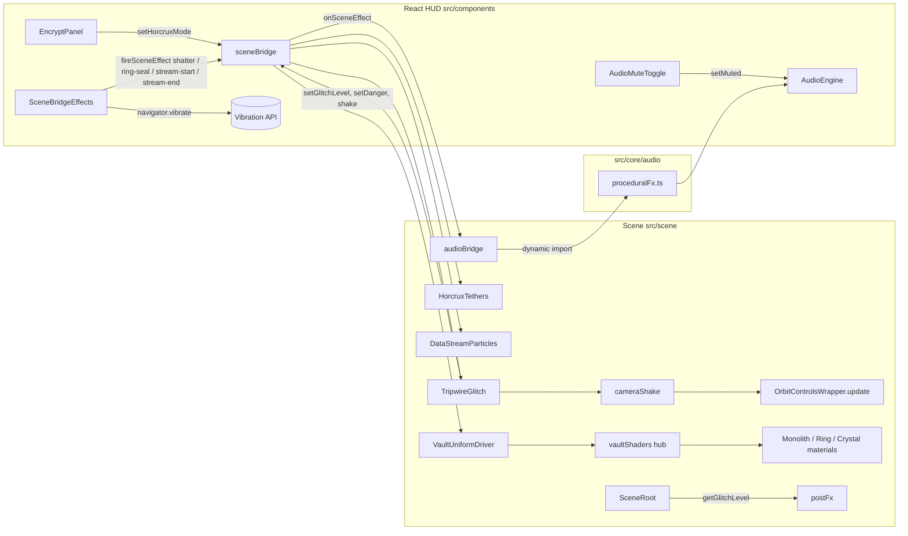

# Design Document

## Overview

This design adds, in TypeScript on top of the existing Three.js scene and Web Audio layer:

1. A 1.5 s crimson tripwire glitch (RGB split, red scanline pulse, tint), a damped camera shake, a `uDanger = 1` override on the artifact shaders, and procedural static plus alarm audio (Requirements 1, 2, 9).
2. Always-visible Horcrux tethers between the Monolith, Crystal and Ring while Horcrux Mode is on (Requirements 3, 4).
3. Custom `ShaderMaterial`s with Fresnel rim and procedural rune veining for the Monolith, the Cryptex Ring segments and the Crystal (Requirement 7).
4. A `THREE.Points` data stream during Encrypt & Embed with a rising harmonic tone (Requirement 8).
5. A global audio mute (Requirement 10), needed because the codebase has none today.

All Scene code stays inside the steering constraints: no React setters in the render loop, 4 ms frame budget, every GPU resource disposed through `SceneRegistry`, `sceneSignals` limited to its one boolean, carrier pixels and `THREE.NoColorSpace` untouched, bloom threshold 1.0.

## Findings from the code read

| Question | Finding |
|---|---|
| Where is Horcrux Mode set? | `src/components/EncryptPanel.tsx` line 19: `const [horcrux, setHorcrux] = useState(false)`, passed to `HudSwitch` ("Horcrux Mode") and to `dispatchEncryptEmbed(..., { horcrux })`. It is component-local React state. It is not in `vaultStore` and never reaches the Scene. `DecryptPanel.tsx` has a separate local `Mode = 'standard' \| 'horcrux'` for recovery. |
| What reaches the Scene today for Horcrux? | Only `SceneBridgeEffects.tsx` firing `'ring-seal'` when `s.horcruxShards` changes (after a seal completes). |
| Is there a mute? | No. `grep mute` finds nothing. `AudioEngine` creates its `AudioContext` on the first `pointerdown`/`keydown`, with a master gain of 0.6. |
| Does a bloom-off fallback keep post effects? | No. `SceneRoot` switches to `renderer.render` when `bloomActive` is false, which also drops the RGB-split glitch. This conflicts with Requirement 5.8 and is fixed below. |
| Glitch writers | `ShatterEffect` writes `setGlitchLevel` for 2400 ms. Requirement 1.4 needs it to be 0 at 1500 ms, so there must be a single writer. |
| Camera | `OrbitControlsWrapper.update()` runs in a frame callback registered by `controlsFactory`. OrbitControls rebuilds the camera position from its spherical state each update, so a naive position offset would feed back into the orbit. |
| Existing materials | Monolith: `MeshStandardMaterial`. Ring: 8 `MeshStandardMaterial`s (emissive lerp indigo to emerald) plus one marker material. Crystal: `MeshPhysicalMaterial` with transmission, plus an HDR core `MeshBasicMaterial`. |

### Horcrux Mode resolution

Decision: `EncryptPanel` writes the flag to `sceneBridge` whenever its local switch changes. The local `useState` remains the source of truth for the form; the bridge holds a mirror.

```
EncryptPanel (useState horcrux)
   └─ onChange → setHorcrux(v); setHorcruxMode(v)        // src/scene/sceneBridge.ts
sceneBridge: let horcruxMode = false; getHorcruxMode()
HorcruxTethers frame callback: group.visible = getHorcruxMode()   // once per frame
```

Why not lift it into `vaultStore`: the flag is display-only, nothing else needs it, and `XRayLensToggle` already sets a Scene flag by calling `sceneBridge` directly. A cleanup effect in `EncryptPanel` calls `setHorcruxMode(false)` on unmount. The Decrypt panel's Horcrux tab does not drive tethers (out of scope; Requirement 3 says "Horcrux_Mode", which is the encrypt switch).

## Architecture



Layering: the Scene imports nothing from `components/` or `store/`. Audio is reached only through `audioBridge.ts` (dynamic import, own chunk), as today. `core/audio` imports no Three.js and no React.

### Frame callback order

`SceneRegistry.runFrame` runs callbacks in registration order. `defaultArtifacts.ts` becomes:

```ts
export const DEFAULT_ARTIFACTS = [
  createVaultUniformDriver,   // new: writes shared uniforms first
  createObsidianMonolith,
  createCryptexRing,
  createEtherealCrystal,
  createCarrierFace,
  createShatterEffect,
  createTripwireGlitch,       // new: sole writer of glitch level, danger, shake
  createHorcruxTethers,       // new: after artifacts exist
  createDataStreamParticles,  // new
  controlsFactory,            // calls orbit.update(), which applies cameraShake
  audioBridgeFactory,
];
```

## Components and Interfaces

### 1. `src/scene/sceneBridge.ts` (extended)

```ts
export type SceneEffect =
  | 'shatter' | 'ring-seal'
  | 'stream-start' | 'stream-end';   // new, encrypt pipeline only

export function setHorcruxMode(on: boolean): void;   // notifies subscribers only on change
export function getHorcruxMode(): boolean;
export function setDanger(level: 0 | 1): void;       // read by VaultUniformDriver
export function getDanger(): number;
// resetSceneBridge() also resets horcruxMode and danger.
// Test hook: effectListenerCount(): number   (for Requirement 5.4)
```

Only booleans and numbers. No key material.

### 2. `src/scene/artifacts/vaultShaders.ts` (new)

Shared uniforms (one object per scene, held per `SceneRegistry` through a `WeakMap`, the same pattern as `getArtifactState(registry.events)`):

```ts
export interface VaultUniforms {
  uTime:     { value: number };  // seconds
  uEnergy:   { value: number };  // 0..1 eased, pipeline activity
  uDanger:   { value: number };  // 0..1, 1 during the tripwire glitch
  uXRayMode: { value: number };  // 0..1 eased, X-Ray lens
}
export function getVaultUniforms(registry: SceneRegistry): VaultUniforms;

export type VaultKind = 'monolith' | 'ring' | 'crystal';
export interface VaultMaterialOptions {
  kind: VaultKind;
  baseColor: THREE.ColorRepresentation;
  runeColor: THREE.ColorRepresentation;     // multiplied into HDR (> 1)
  seed: number;                              // decorrelates veining per artifact
}
export function createVaultMaterial(u: VaultUniforms, o: VaultMaterialOptions): THREE.ShaderMaterial;

// Per-material uniforms: uHover (0..1), uPulse (0..1), uRuneColor, uBaseColor, uSeed.
// Pure helpers mirrored in TS for tests:
export function fresnel(nDotV: number, power?: number): number;       // (1 - clamp(nDotV))^power
export function easeToward(current: number, target: number, deltaMs: number, tauMs: number): number;
export function runeIntensity(n: number, flow: number, danger: number): number; // 0..HDR
```

Shader design (GLSL, `ShaderMaterial`, `fog: false`, `toneMapped: false` handled by `OutputPass`):

- Vertex: pass object-space position `vPos`, view-space normal `vN`, view direction `vV`.
- Fragment:
  - Base: `uBaseColor` with a cheap view-dependent sheen so the obsidian does not read flat.
  - Fresnel rim: `pow(1.0 - saturate(dot(N, V)), 3.0)`, tinted indigo by default, mixed to crimson by `uDanger`, to cyan by `uXRayMode`, scaled by `1 + uEnergy`.
  - Rune veining: 3-octave ridged value noise on `vPos * freq + seed`, thresholded into thin strokes (`smoothstep` on `1 - abs(2n - 1)`), animated by `uTime` along the noise domain. Stroke colour is `uRuneColor * (2.0 + 2.0 * uEnergy + 2.0 * uPulse)`, so it exceeds 1 and crosses the bloom threshold. `uDanger` flips the stroke colour to `#ef4444` HDR and raises flicker.
  - Includes `<tonemapping_fragment>` and `<colorspace_fragment>` so the output is correct if `PostFx` creation fails and the plain renderer path runs.
- Crystal variant: `transparent = true`, `depthWrite = false`, alpha = `0.25 + 0.6 * fresnel`, so it keeps a glassy look without `transmission` (a `ShaderMaterial` has no transmission pass). The HDR core mesh stays a `MeshBasicMaterial`.
- Fog: `fog: false`. The artifacts sit within a few units of the camera, so `FogExp2(0.035)` is a small difference. Noted as an accepted visual change.

Changes in the artifacts (geometry, picking, state emission unchanged):

| File | Change |
|---|---|
| `ObsidianMonolith.ts` | Replace `MeshStandardMaterial` by `createVaultMaterial(kind 'monolith')`. The existing `glow` ease writes `material.uniforms.uHover.value` instead of `emissiveIntensity`. |
| `CryptexRing.ts` | Each segment gets `createVaultMaterial(kind 'ring')`. `pulse[i]` writes `uPulse`; the indigo to emerald lerp becomes a `uRuneColor.lerpColors` call. Hover writes `uHover`. Marker material stays. |
| `EtherealCrystal.ts` | `MeshPhysicalMaterial` replaced by `createVaultMaterial(kind 'crystal')`. `level` (hover/resonance) writes `uHover`. Core unchanged. Exported pure helpers `advanceGlowProgress` and `glowIntensity` stay. |

### 3. `src/scene/artifacts/VaultUniformDriver.ts` (new, `createVaultUniformDriver`)

One frame callback per frame:

```ts
u.uTime.value     = timeMs / 1000;
u.uEnergy.value   = easeToward(u.uEnergy.value,   isPipelineActive() ? 1 : 0, dt, 300);
u.uXRayMode.value = easeToward(u.uXRayMode.value, getXrayLens() ? 1 : 0,      dt, 140);
u.uDanger.value   = getDanger();                   // hard override, no easing
```

It reads `sceneSignals` (the existing boolean) and `sceneBridge`. It allocates nothing.

### 4. `src/scene/artifacts/TripwireGlitch.ts` (new, `createTripwireGlitch`)

Sole writer of the glitch level, danger flag and camera shake. State is one object `{ elapsed: number }` with `elapsed < 0` meaning idle, so a second `'shatter'` simply sets `elapsed = 0` (single instance, Requirement 1.5).

```ts
export const GLITCH_DURATION_MS = 1500;
export const CRIMSON = 0xef4444;

/** 0 for t < 0 or t >= duration; sharp spike then flickering decay in between. */
export function crimsonEnvelope(tMs: number, durationMs = GLITCH_DURATION_MS): number;
/** Damped shake offset in scene units; 0 for t >= duration or when reduced motion. */
export function shakeOffset(tMs: number, reducedMotion: boolean, out: {x:number;y:number}): void;
export function stepGlitch(elapsed: number, deltaMs: number): number; // -1 when finished
```

Per frame while active: `elapsed += dt`; `setGlitchLevel(crimsonEnvelope(elapsed))`; `setDanger(1)`; `setShake(shakeOffset(...))`. At `elapsed >= 1500`: `setGlitchLevel(0)`, `setDanger(0)`, `setShake(0,0)`, `elapsed = -1`. Cleanup unsubscribes the effect listener and the frame callback and resets all three outputs.

`ShatterEffect.ts` change: delete its `setGlitchLevel(...)` calls (three call sites: frame, completion branch, cleanup). Shard burst, light flash, 2400 ms timing and `glitchEnvelope`/`shardLife` exports stay. `glitchEnvelope` remains exported and tested; it is simply no longer wired to the compositor.

`CarrierFace.ts` keeps reading `getGlitchLevel()`; it now sees the 1.5 s crimson level.

Reduced motion: `window.matchMedia('(prefers-reduced-motion: reduce)')` is read once at mount (guarded for `matchMedia` being absent) and kept in a closure boolean.

### 5. `src/scene/cameraShake.ts` (new)

```ts
export function setShake(x: number, y: number): void;
export function applyShake(camera: THREE.Camera): void;   // adds the pending offset, remembers it
export function removeShake(camera: THREE.Camera): void;  // subtracts exactly what was added
```

`OrbitControlsWrapper.update()` becomes `removeShake(camera); controls.update(); applyShake(camera);`. The orbit always integrates from an unshaken position, so the orbit target and damping state are never perturbed, and when the shake reaches 0 the camera position equals the orbit's own result. `cameraShake.ts` keeps only plain numbers and a `Vector3`-free implementation (the camera's `position.x/y` are modified through the passed object). Shake is deterministic (`sin` at two incommensurate frequencies times `exp(-t/τ)` times a linear fade to 0 at 1500 ms); no `Math.random()`.

### 6. `src/scene/postFx.ts` (extended)

```ts
export interface PostFx {
  // existing: render, setSize, setActivity, setGlitch(level), dispose
  setTripwire(level: number, timeSec: number): void;  // new
  setBloomEnabled(enabled: boolean): void;            // new
}
```

- A new `ShaderPass` with an inline `TRIPWIRE_SHADER` (`tDiffuse`, `uLevel`, `uTime`) sits after the RGB shift pass and before `OutputPass`. It adds a crimson tint (`#ef4444`-based, HDR-safe, clamped) and a horizontal scanline band that sweeps down the frame (`sin` on `uv.y * lines - uTime * speed`) with a red pulse. `enabled = level > 0.002`, same threshold as the RGB pass, so the pass is skipped entirely at 0.
- Chromatic aberration is provided by the existing `RGBShiftShader` pass driven by `setGlitch`.
- `setBloomEnabled(false)` sets `bloomPass.enabled = false`. The composer keeps running, so the glitch passes still render. The bloom threshold constant stays `1.0`.
- `dispose()` also calls `tripwirePass.dispose()`.

`SceneRoot.tsx` changes:

```ts
const g = getGlitchLevel();
postFx.setGlitch(g);
postFx.setTripwire(g, now / 1000);
postFx.setActivity(activity);
postFx.render(delta / 1000);
...
if (bloomActive && !quality.bloomEnabled) { bloomActive = false; postFx?.setBloomEnabled(false); }
```

The branch `if (postFx && bloomActive)` becomes `if (postFx)`; the plain `renderer.render` path remains only when composer creation throws.

### 7. `src/scene/artifacts/HorcruxTethers.ts` (new, `createHorcruxTethers`)

- One `THREE.Group` (`name: 'horcrux-tethers'`) holding one `THREE.LineSegments` with a single preallocated `BufferGeometry`: 3 curves (Monolith-Crystal, Crystal-Ring, Monolith-Ring) × 24 segments = 72 segments, 144 vertices. Attributes: `position` (dynamic, 432 floats) and `aT` (static, 0..1 along each curve).
- Each curve is a quadratic Bezier with its control point lifted by a sag above the chord midpoint, so the Monolith-Ring tether does not pass through the Crystal.
- Material: `ShaderMaterial` with `uTime`, `uPulse`, `uColor`. Fragment colour is HDR (`vec3(0.6, 1.4, 2.6) * (1.6 + band)`), where `band` is a travelling bright pulse along `aT`; `uPulse` adds a one-off surge. Always above 1, so it glows under the 1.0 threshold. `transparent`, `depthWrite = false`, `fog = false`.
- Endpoints come from the live objects, looked up each frame by name and cached: `ObsidianMonolith`, `ethereal-crystal`, `cryptex-ring`. All three are direct scene children, so `object.position` is the world position (no matrix math). If an object is missing, its tethers collapse to degenerate segments.
- Per frame: `group.visible = getHorcruxMode()`; if not visible, return immediately (zero cost when off); otherwise rewrite 432 floats and set `needsUpdate`. No allocation (module-level scratch vectors).
- Pulse: `onSceneEffect` listener sets `pulse = 1` when effect is `'ring-seal'` and `getHorcruxMode()`; decays with the existing `decayPulse(pulse, dt, 1000)`.
- Cleanup: unsubscribe listener and frame callback, remove group, dispose geometry and material (also registered with `registry`).

### 8. `src/scene/artifacts/DataStreamParticles.ts` (new, `createDataStreamParticles`)

- One `THREE.Points`, 600 particles, `BufferGeometry` with preallocated `position`, `color` (cyan `#22d3ee` or violet `#a855f7`, HDR scaled by 1.8 so it blooms) and a per-particle `phase` array. `PointsMaterial` with `vertexColors`, `size`, `sizeAttenuation`, `transparent`, `depthWrite = false`, `blending = AdditiveBlending`.
- Layout: a double spiral rising into the Crystal. For particle `i`, with progress `p = fract(phase + t * speed)`: angle `θ = p * 6π + i * twist`, radius shrinking as it nears the crystal, `y` rising from the pedestal. Pure function `spiralPosition(i, tSec, out)` for tests.
- Lifecycle controller (pure, `streamStep(state, deltaMs, event)`): `'idle' → 'running'` on `'stream-start'`; `'running' → 'fading'` on `'stream-end'`; `'fading'` reduces `opacity` linearly to 0 over `STREAM_FADE_MS = 600`, then `'idle'` and `points.visible = false`. A new `'stream-start'` during fading returns to `'running'`.
- Idle cost: `points.visible = false` and an early return in the frame callback.
- `SceneBridgeEffects` fires `'stream-start'`/`'stream-end'` only from `encryptStatus.state` transitions (see below), so decrypt never triggers it.

### 9. HUD changes

`EncryptPanel.tsx`: the `HudSwitch onChange` handler becomes `(v) => { setHorcrux(v); setHorcruxMode(v); }`; add `useEffect(() => () => setHorcruxMode(false), [])`.

`SceneBridgeEffects.tsx` (adds to the existing subscribe callback):

```ts
const ACTIVE = new Set<PipelineState>(['deriving','encrypting','embedding','auditing']);
const was = ACTIVE.has(prev.encryptStatus.state), is = ACTIVE.has(s.encryptStatus.state);
if (!was && is) fireSceneEffect('stream-start');
if (was && !is) fireSceneEffect('stream-end');
if (!prev.tripwire.tripped && s.tripwire.tripped) { fireSceneEffect('shatter'); triggerTripwireVibration(); }
```

`'auditing'` is included because the demo flow audits as part of encrypt; the stream ends when the encrypt state returns to `complete`/`error`/`idle`.

`src/components/tactile.ts` (new): `TRIPWIRE_VIBRATION = [200, 80, 200, 80, 400] as const` (sum 960 ms, at most 1500) and `triggerTripwireVibration(nav = navigator)`: `if (typeof nav?.vibrate === 'function') nav.vibrate([...TRIPWIRE_VIBRATION])`, wrapped in `try/catch`. Absent API: no-op, audio still plays.

`src/components/AudioMuteToggle.tsx` (new): a `HudSwitch`-style button with Lucide `Volume2`/`VolumeX`, placed under `XRayLensToggle` in the top-left of `App.tsx`. It calls `getAudioEngine().setMuted(...)` through a dynamic import so the audio chunk stays lazy. Its local state mirrors `engine.muted` via `engine.onMuteChange`.

### 10. Audio

`src/core/audio/AudioEngine.ts` (extended):

```ts
get muted(): boolean;
setMuted(muted: boolean): void;     // master.gain = 0 when muted, restores prior gain on unmute
get canPlay(): boolean;             // ctx !== null && ctx.state === 'running' && !muted && master !== null
onMuteChange(cb: (muted: boolean) => void): () => void;
```

`setMuted` stores `preMuteGain = master.gain.value` before zeroing and restores it on unmute; before the context exists it stores the flag and applies it in `initialize()`. Because the master gain is zeroed, existing ambient, ring click and shard sounds are muted too (Requirement 10.2). Autoplay is unchanged: no context exists until the first user gesture.

`src/core/audio/proceduralFx.ts` (new, no Three.js, no React, no audio files):

```ts
export function riseFrequency(progress: number, rootHz?: number): number;   // monotonic non-decreasing in [0,1]
export interface StreamTone { finish(): void; stop(): void }
export function startHarmonicRise(engine = getAudioEngine()): StreamTone | null;
export function playTripwire(engine = getAudioEngine(), durationMs = 1500): void;
```

- Every function begins with `if (!engine.canPlay) return null/void;` and wraps node creation in `try/catch`, so a missing, suspended or muted context creates no nodes and raises nothing (Requirements 2.5, 9.5).
- `startHarmonicRise`: 4 sine partials at 1x, 2x, 3x, 5x of a root that glides from 110 Hz upward via `exponentialRampToValueAtTime` while higher partials fade in; `finish()` resolves to a short major-third chord and releases; `stop()` cuts with a 40 ms fade. A hard cap timer (30 s) stops a stuck tone.
- `playTripwire`: white noise `AudioBuffer` (filled with `Math.random()`, non-security audio texture as in `generateImpulseResponse`) through a band-pass filter with gain envelope to 0 at 1500 ms, plus a square-wave alarm alternating 880 Hz and 660 Hz every 150 ms, gain below 0.3, all disconnected on `onended`.

`audioBridge.ts` adds one `onSceneEffect` subscription in the existing `.then` block:

```ts
let tone: StreamTone | null = null;
cleanups.push(onSceneEffect((e) => {
  if (e === 'stream-start') { tone?.stop(); tone = fx.startHarmonicRise(); }
  else if (e === 'stream-end') { tone?.finish(); tone = null; }
  else if (e === 'shatter') fx.playTripwire();
}));
cleanups.push(() => { tone?.stop(); tone = null; });
```

The dynamic import is `import('../core/audio/proceduralFx')`. The listener is added inside the `.then` and removed in cleanup, and the `disposed` check at the start of `.then` prevents a listener registering after unmount (Requirement 5.4).

## Data Models

```ts
// sceneBridge additions (module state)
let horcruxMode = false;     // boolean
let danger = 0;              // 0 | 1

// TripwireGlitch controller state
interface GlitchState { elapsed: number }            // -1 = idle

// DataStreamParticles controller state
type StreamPhase = 'idle' | 'running' | 'fading';
interface StreamState { phase: StreamPhase; fadeMs: number; opacity: number }

// HorcruxTethers
interface TetherState { pulse: number }              // 0..1
const PAIRS = [['monolith','crystal'], ['crystal','ring'], ['monolith','ring']] as const;
```

No payload, passphrase or key material appears in any of these.

## Error Handling

- WebGL/shader compile failure: `ShaderMaterial` compile errors surface in the console from Three.js; `SceneRoot` already falls back to `WebGLFallback` when the renderer cannot be created. Shader sources are plain strings validated by unit tests that check required symbols; no runtime fallback material is added.
- Missing artifact objects (tethers): the tether collapses to a degenerate segment for that frame; no throw.
- Missing `matchMedia`, `navigator.vibrate`, `AudioContext`: each feature is skipped (`typeof` guards, `try/catch`).
- Audio: all `proceduralFx` entry points check `engine.canPlay` and swallow exceptions, matching the "suppress silently" rule used by `TactileSFX`.
- Context loss: `SceneRoot` remounts; every new factory re-creates its resources and its cleanup disposes the old ones.
- Logging: none of the new code calls `console.*`; nothing carries plaintext, passphrases or key material (Requirement 5.9).

## Testing Strategy

Dual approach with Vitest and fast-check (already in `package.json`). Property tests run at least 100 iterations and carry the tag `Feature: vault-visual-drama-tactile-feedback, Property N: <title>`. Pure helpers (`crimsonEnvelope`, `stepGlitch`, `shakeOffset`, `easeToward`, `fresnel`, `streamStep`, `riseFrequency`, `spiralPosition`) carry the property tests. Scene factories are tested with a real `THREE.Scene` and `SceneRegistry` without a GL context (no rendering), matching the existing artifact tests. Web Audio is tested with a fake `AudioEngine` exposing counters on `createOscillator` and `createGain`.

Example and smoke tests: shatter shard lifetime unchanged (1.2); `SceneBridgeEffects` fires `shatter` on trip (1.6); vibration with and without `navigator.vibrate` and pattern sum at most 1500 (2.1-2.3); alarm starts one oscillator (2.4); tether colours exceed 1 (3.5); `ShaderMaterial` type and shader source contains Fresnel and rune functions (7.1, 7.2); preallocated array identity (8.3); `setBloomEnabled(false)` leaves the glitch passes enabled using a mocked composer (5.8); disposal spies (5.3); source-text scan that new scene files do not import `components/`, `store/` or `core/crypto` and contain no `console.` (4.5, 5.9); existing artifact tests keep passing (7.7). Frame-budget checks (5.1, 5.2) are manual profiling with the existing `scene-frame-overrun` event, not automated.

## Correctness Properties

*A property is a characteristic or behavior that should hold true across all valid executions of a system-essentially, a formal statement about what the system should do. Properties serve as the bridge between human-readable specifications and machine-verifiable correctness guarantees.*

### Property 1: Glitch timeline is bounded to 1500 ms

For any sequence of positive frame deltas applied after a `'shatter'` effect, the glitch level and danger flag are non-zero while the accumulated time is below 1500 ms (within 100 ms tolerance at the end), and the glitch level is 0, danger is 0 and the RGB-split and scanline passes are disabled once the accumulated time reaches 1500 ms.

**Validates: Requirements 1.1, 1.4, 9.1, 9.3**

### Property 2: Restarting the glitch yields a single instance

For any elapsed time `t` in `[0, 1500)` at which a second `'shatter'` effect arrives, the glitch elapsed counter resets to 0, exactly one glitch state exists, and the glitch ends 1500 ms after the second trigger.

**Validates: Requirements 1.5**

### Property 3: Quiet audio states create no sound

For any audio engine state in {no context, suspended context, muted} and any of `startHarmonicRise` and `playTripwire`, the call does not throw and creates no audio nodes. When the context is running and unmuted, the call creates at least one node.

**Validates: Requirements 2.5, 9.5**

### Property 4: Horcrux mode flag round trip and tether visibility

For any sequence of boolean writes to `setHorcruxMode`, `getHorcruxMode` returns the last value written, subscribers are notified only when the value changes, and after the next frame `HorcruxTethers` group visibility equals that last value, independent of hover, selection or pipeline state.

**Validates: Requirements 3.1, 3.2, 3.3, 3.4, 4.1, 4.2, 4.3**

### Property 5: Tethers follow live artifact positions

For any positions of the Monolith, Crystal and Ring objects, after a frame each tether's first and last vertices equal the position of its two artifacts (plus the fixed anchor offsets).

**Validates: Requirements 3.6**

### Property 6: Ring-seal pulses tethers once, only in Horcrux mode

For any Horcrux mode value, firing `'ring-seal'` sets the tether pulse above 0 if and only if the mode is on, and the pulse decays back to 0 with no further input.

**Validates: Requirements 3.7**

### Property 7: No listener leak across mounts

For any number N of mount and unmount cycles of the new factories (`createTripwireGlitch`, `createHorcruxTethers`, `createDataStreamParticles`, `audioBridgeFactory`), the number of registered `onSceneEffect` listeners after the last unmount equals the count before the first mount.

**Validates: Requirements 5.4**

### Property 8: Carrier pixels are never modified

For any `Uint8ClampedArray` carrier preview, running any number of frames with the glitch active and tethers visible leaves the buffer bytes identical to the original.

**Validates: Requirements 5.5**

### Property 9: Shared shader uniforms are single values

For any number of vault materials created from one uniform hub, every material's `uTime`, `uEnergy`, `uDanger` and `uXRayMode` uniform is the same object as the hub's, so one write is seen by all.

**Validates: Requirements 7.3**

### Property 10: Easing stays in range and moves toward the target

For any current value in `[0, 1]`, target in `{0, 1}`, and positive delta, `easeToward` returns a value in `[0, 1]` that is not farther from the target than the input, so `uEnergy` and `uXRayMode` converge.

**Validates: Requirements 7.4, 7.5**

### Property 11: Data stream lifecycle

For any sequence of encrypt pipeline states, a `'stream-start'` effect is fired exactly when the state moves from inactive to active and `'stream-end'` exactly when it moves from active to inactive; the stream controller is `running` after a start, reaches opacity 0 and phase `idle` within 600 ms after an end, and decrypt-only state sequences never produce either effect.

**Validates: Requirements 8.1, 8.2, 8.5**

### Property 12: Harmonic rise is monotonic

For any `p1 <= p2` in `[0, 1]`, `riseFrequency(p1) <= riseFrequency(p2)`.

**Validates: Requirements 8.4**

### Property 13: Camera shake is damped and reversible

For any time `t >= 1500 ms` the shake offset is exactly 0; for any `t` the magnitude never exceeds the initial amplitude; for any camera position and any shake offset, `applyShake` followed by `removeShake` restores the exact original position, so the orbit state is unchanged.

**Validates: Requirements 9.2**

### Property 14: Reduced motion disables shake

For any time `t`, with the reduced-motion flag set, `shakeOffset` is 0 while the glitch level is still produced.

**Validates: Requirements 9.6**

### Property 15: Mute round trip restores gain

For any master gain value `g` in `(0, 1]`, `setMuted(true)` followed by `setMuted(false)` leaves the master gain equal to `g`, and while muted `canPlay` is false.

**Validates: Requirements 10.1, 10.2, 10.3**
