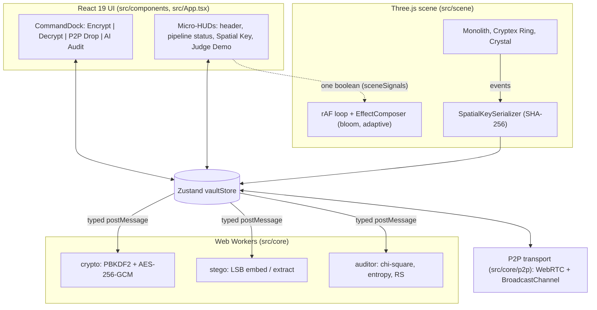

# Cryptex3D

**A zero-backend encrypted dead drop disguised as a haunted 3D vault.** Built for the Kiroween 2026 Hackathon, Frankenstein category.

Cryptex3D encrypts a file with AES-256-GCM, hides the ciphertext in the least significant bits of a lossless 1024×1024 PNG, audits the result with steganalysis statistics, and hands it to a peer over WebRTC or BroadcastChannel. The rotation state of three 3D artifacts (an obsidian monolith, an 8-segment cryptex ring, an ethereal crystal) is the **Spatial Key**. It is mixed into the key derivation, so the right passphrase with the wrong artifact positions fails authentication instead of returning wrong bytes.

Everything runs in the browser. There is no server, no signaling service, and no account.

## Highlights

- **Command Dock**: one tabbed panel (Encrypt, Decrypt, P2P Drop, AI Audit) with a Zen toggle that hides it, so the vault fills the screen.
- **Cinematic scene**: ACES tone mapping, exponential fog, rune-etched pedestals, three-point plus cyan rim lighting, selective bloom, idle levitation, hover glow, and an emerald lock-in pulse when a ring segment settles. Bloom turns itself off if frames run over budget.
- **Judge Demo Mode**: one click runs the full pipeline (Encrypt, Audit, P2P Sync, 3D Unlock, Decrypt) with a live stepper and a 60 s deadline.
- **One-person P2P test**: **Open Receiver Tab** opens a second tab on the same origin so a single judge can watch a transfer.
- **Steganalysis gauge**: a 0-100 undetectability meter, chi-square, Shannon entropy and LSB-pair bars, and payload-density advice.
- **Strict CSP**: `default-src 'self'; worker-src 'self' blob:`. Fonts are bundled locally (Inter Variable, JetBrains Mono). No CDNs, no inline styles.

## Architecture



| Layer | Location | Responsibility |
|---|---|---|
| React 19 UI | `src/components/`, `src/App.tsx`, `src/store/` | HUD and application state. Never imports Three.js and never performs crypto inline. |
| Three.js scene | `src/scene/` | The 60 fps loop, artifacts, post-processing, environment, orbit controls, `SpatialKeySerializer`, `WebGLFallback`. |
| Web Worker pipelines | `src/core/crypto/`, `src/core/stego/`, `src/core/auditor/` | CPU-heavy work off the main thread. One lazily started worker per pipeline, terminated after 30 s idle. |
| P2P transport | `src/core/p2p/` | WebRTC `RTCDataChannel` with copy-paste or QR SDP, plus a `BroadcastChannel("cryptex3d-p2p")` fallback. Moves raw bytes only. |

Procedural audio lives in `src/core/audio/`. Vite splits `three`, `react`, `tailwind`, per-worker, `p2p`, `p2p-qr` and `auditor-ml` chunks. Assets are never inlined, because the CSP blocks `data:` URIs.

### Pipeline

```
passphrase + Spatial Key
   [1] derive key (PBKDF2-SHA-256, 310 000 iterations) -> [2] encrypt (AES-256-GCM)
   [3] embed into carrier PNG LSBs                      -> [4] audit (advisory)
   [5] transfer (WebRTC or BroadcastChannel)
   [6] extract (magic + SHA-256 verified)               -> [7] decrypt
```

Bitstream layout (`src/core/stego/BitstreamLayout.ts`): 8-byte magic `43 52 59 50 54 33 44 00`, 4-byte big-endian payload length, payload (`iv || salt || ciphertext+tag`), then a 32-byte SHA-256 over everything before it. Bits go into the LSBs of R, G and B only. Alpha is never touched.

### Spatial Key

The serialized scene state is the monolith rotation (X, Y, Z), the positions (0-9) of the 8 ring segments, and the crystal's activation. `SpatialKeySerializer` writes them in a fixed order and takes the SHA-256 as a 64-character hex hash, shown in the bottom-left HUD. The PBKDF2 salt is `SHA-256(passphrase + serializedHash)[0..15]`.

### Carrier integrity in the scene

Any carrier texture goes through `src/scene/carrierTexture.ts`: `THREE.NoColorSpace`, `generateMipmaps = false`, `NearestFilter` for min and mag, `Uint8ClampedArray` pixel data. Nothing re-encodes, resizes or colour-converts a carrier after embedding.

## How Kiro was used

- **Specs** (`.kiro/specs/cryptex3d/`): requirements, a design document with correctness properties, and a task list drove the build in a design-first workflow. The overhaul is recorded as an appendix in `design.md`.
- **Steering** (`.kiro/steering/`): three always-on documents. `architecture.md` fixes the layer boundaries (UI never imports Three.js, the render loop never calls React setters, workers never import React). `stego-security.md` fixes the cryptography and bitstream invariants. `ui-theme.md` fixes the Haunted Cyber-Vault visual language. Every generated change was checked against them. For example, the steering forbids gradient button fills, so buttons stay flat.
- **Hooks** (`.kiro/hooks/`): `crypto-stego-test` runs the suite when crypto or stego code is saved. `csp-guard` fails when a saved file adds an inline `style`, which the CSP would block in production. `repo-hygiene` checks at session start that `.kiro` is not git-ignored and the MIT `LICENSE` exists.
- **Property-based testing** (`tests/property/`, fast-check): AES round trip, wrong-key rejection, LSB round trip and carrier losslessness, payload-size limits, Spatial Key hash sensitivity, ring-segment arithmetic, no plaintext leakage, and non-blocking worker behavior. Unit tests cover the auditor, the bitstream, the P2P framing, the demo orchestration, and the scene helpers added in the overhaul (adaptive bloom, ring lock-in, demo stepper, audit metrics).

## Quick start

Requires Node.js 20 or newer and a browser with WebGL2, Web Crypto and module Workers.

```bash
git clone https://github.com/irsyadazaki77-beep/cryptex3d.git
cd cryptex3d
npm install
npm run dev        # http://localhost:5173
```

| Command | Purpose |
|---|---|
| `npm run dev` | Vite dev server (no CSP, because HMR needs inline scripts and a websocket) |
| `npm run build` | `tsc --noEmit` then `vite build` |
| `npm run preview` | Serve `dist/` with the production CSP header |
| `npm run test` | `vitest --run` over unit, property and integration tests |

### Deploying to Vercel

Import the repository. `vercel.json` sets the build command, the `dist` output directory, the same CSP as a response header, `nosniff`, `no-referrer`, and immutable caching for `/assets/`. No environment variables are needed.

## Try it

### Judge Demo Mode

Click **Judge Demo Mode** at the bottom of the screen. It sets a fixed Spatial Key, encrypts a 1 024-byte payload, embeds and audits it, moves the carrier over `BroadcastChannel`, extracts and decrypts it. The stepper shows Encrypt, Audit, P2P Sync, 3D Unlock, Decrypt. It ends with "Payload matches original" or "Demo timed out" after 60 s.

### Two tabs, one person

1. In **P2P Drop**, click **Open Receiver Tab**. In both tabs, enable **Same-Device Mode**.
2. Sender: rotate the monolith, click ring segments and hover the crystal. Note the hash in the Spatial Key readout.
3. Sender: in **Encrypt**, choose a file (up to 250 KB), enter a passphrase of 8-64 characters, and click **Encrypt & Embed**. Check **AI Audit** for the gauge and density advice.
4. Sender: in **P2P Drop**, click **Send carrier**. The carrier appears in the receiver's **Decrypt** tab.
5. Receiver: set the artifacts to the same positions, enter the passphrase, click **Extract & Decrypt**, then download the file.

A wrong Spatial Key or passphrase gives an authentication failure with no output. Ten attempts are allowed per carrier, then you must re-initiate.

### Across devices

In **P2P Drop**, the sender copies the SDP offer (text or QR) to the recipient out of band. The recipient pastes back the answer, then the sender clicks **Send carrier**. If ICE does not connect within 30 s, the panel offers **Switch to Same-Device Mode**.

## Security notes

- **Encryption**: AES-256-GCM through `crypto.subtle` only. 12-byte random IV per call, 128-bit tag. No third-party crypto libraries.
- **Key derivation**: PBKDF2-HMAC-SHA-256, 310 000 iterations, 16-byte salt bound to the passphrase and the Spatial Key. Derived keys are non-extractable.
- **No backend**: the app makes no network calls of its own.
- **Limits**: 250 KB (256 000 bytes) of ciphertext. Larger input is rejected before any pixel changes.
- **Integrity**: extraction verifies the magic header and checksum before decrypting.
- **No leaks**: plaintext, passphrases and key material are never logged, and error text is sanitized.
- **Auditor**: runs in a worker on the LSB plane only. Advisory, never blocks the pipeline.

## Known limitations

- **PNG codec paths are browser-only.** Decode and encode use `OffscreenCanvas` and `createImageBitmap`, which the Node test environment lacks. Tests cover crypto, bitstream, LSB, auditor and transport logic on raw pixel buffers.
- **Advanced audit needs a local model** at `/models/cryptex-audit`. None is shipped. Without it the audit uses the heuristic score.
- **The demo passphrase is public** (`DEMO_PASSPHRASE` in `src/components/demoOrchestration.ts`). Never use it for real data.
- **The SDP offer QR code may not render in the production build.** It is a `data:` URL image, and the strict CSP (`default-src 'self'`) blocks `data:` images. Copy-paste SDP works. Allowing it needs `img-src 'self' data:`.
- **No carrier download button.** The carrier moves through P2P Drop. The Decrypt tab can load a PNG from disk.
- **The carrier must stay lossless.** Re-encoding or resizing it destroys the payload.
- **The Spatial Key is shared out of band**, and rotation values are continuous, so matching the monolith by hand is hard.
- **Performance targets** (60 fps, initial bundle) depend on hardware. Verify with a browser profile.
- **Manual SDP only.** No STUN/TURN servers are configured, so WebRTC generally connects only on a shared LAN. Use Same-Device Mode otherwise.

## License

MIT. See [LICENSE](LICENSE).
